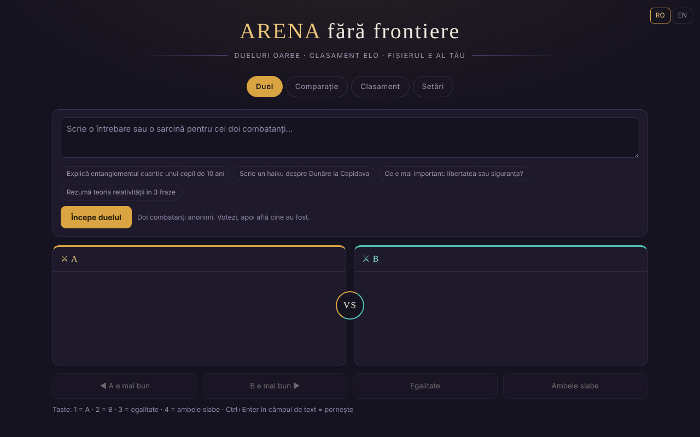

# Arena ohne Grenzen

[English](README.md) · [Română](README.ro.md) · [Français](README.fr.md) · [Italiano](README.it.md) · [Español](README.es.md) · [Português](README.pt.md) · **Deutsch** · [Magyar](README.hu.md)

**Version:** 1.2.0 · **Zuletzt aktualisiert:** 2026-10-18

Blinde Duelle zwischen KI-Modellen, mit lokaler Elo-Rangliste — in einer einzigen HTML-Datei.

**Online-Anwendung:** https://chiuta.github.io/ARENA/

## Was es ist

ARENA ist eine Anwendung in einer einzigen Datei (`index.html`, reines JavaScript), in der Sie zwei Sprachmodelle vergleichen, ohne zu wissen, welches welches ist: Sie senden denselben Prompt an zwei anonyme „Kämpfer“, stimmen für die bessere Antwort ab, und dann zeigt Ihnen die Anwendung, wer sie waren, und aktualisiert eine Elo-Rangliste. Die Modelle können Cloud-Dienste (mit Ihrem API-Schlüssel), lokale Server oder Engines im Browser sein; es gibt auch Demo-Modelle, die ohne jeden Schlüssel funktionieren.

## Funktionen

- Vier Reiter: **Duell**, **Vergleich**, **Rangliste**, **Einstellungen**.
- Blindes Duell: Schaltflächen „A ist besser“, „B ist besser“, „Unentschieden“, „Beide schlecht“; nach der Abstimmung werden die Modelle enthüllt.
- Vergleich: Sie wählen die beiden Kämpfer selbst aus, ohne Abstimmung und ohne Elo.
- Lokale Elo-Rangliste (beginnt bei 1000, K=32; Unentschieden und „beide schlecht“ zählen als Remis), mit einer Schaltfläche „Rangliste zurücksetzen“.
- Einstellungen: Modelle hinzufügen/bearbeiten/löschen (Name, Anbieter, Modell-ID, Base URL, API-Schlüssel), Schaltfläche „Testen“, „Alle aktiven Modelle testen“.
- Anbietertypen: OpenAI-kompatibel, Anthropic, Ollama (lokal), Pollinations (Schlüssel optional), WebLLM (WebGPU), im Browser integrierte KI (Gemini Nano), Transformers.js, dazu Demo-Modelle.
- Ein Katalog einbindbarer KIs (Stand 29. Juli 2026, 181 Einträge, 68 Anbieter laut Text in der Anwendung; am 11. Oktober 2026 nicht erneut geprüft, siehe den Hinweis in der Anwendung), mit Filtern, „+ Alle hinzufügen“ und „⟳“ zum Synchronisieren der Modellliste vom Anbieter.
- „Alles exportieren (JSON)“, „Importieren“, „Alles löschen“.
- Tastenkürzel: `1` / `2` / `3` / `4` stimmen ab (A, B, Unentschieden, beide schlecht), wenn Sie sich nicht in einem Textfeld befinden; `Strg`/`Cmd`+`Eingabe` im Textfeld startet das Duell oder den Vergleich.
- „Rangliste exportieren (CSV)“ (im Reiter Rangliste): lokal erzeugte Datei; Namen, die mit `=`, `+`, `-`, `@` beginnen, werden neutralisiert.
- Option in den Einstellungen: „API-Schlüssel nur für die Sitzung behalten“ — die Schlüssel werden nicht mehr in `localStorage` geschrieben (sie bleiben in `sessionStorage` und verschwinden beim Schließen des Tabs).
- Oberfläche auf Rumänisch, Englisch und Französisch (Auswahl RO / EN / FR in der Kopfzeile; die Demo-Kämpfer antworten in der gewählten Sprache; die Gruppennotizen im KI-Katalog bleiben auf Rumänisch).

## Anleitung

1. Öffnen Sie den Reiter **Einstellungen** und fügen Sie mindestens zwei aktive Kämpfer hinzu: Drücken Sie „+ Modell hinzufügen“, tragen Sie Anbieter, Modell-ID, Base URL und API-Schlüssel ein und dann „Speichern“. Sie können auch die Demo-Modelle ohne Schlüssel verwenden.
2. Drücken Sie „Testen“, um ein Modell zu prüfen, oder „⚡ Alle aktiven Modelle testen“ (Achtung: Jeder Test verbraucht einen Aufruf des Anbieterkontingents; die Anwendung verlangt eine Bestätigung).
3. Gehen Sie zum Reiter **Duell**, schreiben Sie die Frage oder Aufgabe und drücken Sie „Duell starten“. „Stopp“ unterbricht die Generierung.
4. Lesen Sie die beiden Antworten (A und B) und stimmen Sie ab. Dann sehen Sie die Identität der Modelle und das Ergebnis; „Neues Duell“ startet ein weiteres.
5. Reiter **Vergleich**: Wählen Sie manuell zwei Kämpfer aus und drücken Sie „Vergleichen“ für einen direkten Vergleich ohne Wertung.
6. Reiter **Rangliste**: Sehen Sie den Elo-Wert, die Anzahl der Duelle und Siege/Unentschieden/Niederlagen; „Rangliste zurücksetzen“ leert sie.
7. Sicherung: Unter **Einstellungen → Ihre Daten** speichert „Alles exportieren (JSON)“ Modelle, Schlüssel und Rangliste; „Importieren“ lädt sie wieder. Die exportierte Datei enthält die API-Schlüssel, bewahren Sie sie sicher auf.
8. Ändern Sie die Sprache über die Auswahl in der Kopfzeile.

## Datenschutz und Netzwerk

- **Lokaler Speicher:** Alle Daten (Modelle, API-Schlüssel, Rangliste, Verlauf) werden im `localStorage` unter dem Schlüssel `arena-ff-v1` gespeichert. Die API-Schlüssel können in den Einstellungen getrennt gehalten werden, nur im `sessionStorage`. Ist `localStorage` nicht verfügbar, gehen die Daten beim Schließen der Seite verloren.
- **Netzwerk:** Die Anwendung hat keinen eigenen Server und sendet keine Telemetrie. Chat-Anfragen gehen direkt vom Browser an den von Ihnen konfigurierten Anbieter (zum Beispiel `api.openai.com`, `api.anthropic.com`, `gen.pollinations.ai`, `router.huggingface.co`, einen lokalen `localhost`-Server usw.), mit Ihrem Schlüssel.
- **CDN:** Nur wenn Sie die Engines im Browser wählen, werden die Module von `esm.run` importiert (`@mlc-ai/web-llm@0.2.84`, `@huggingface/transformers@4.2.0`) und anschließend die Modellgewichte heruntergeladen (z. B. von Hugging Face).
- **Cloud-Modelle standardmäßig deaktiviert:** Die Katalogmodelle, die keinen Schlüssel verlangen (Kilo Gateway, `api.kilo.ai`: Kilo Auto, GLM-5, MiniMax M2.5, StepFun Step 3.5 Flash), werden der Liste hinzugefügt, aber **deaktiviert**; ihre Aktivierung (Schalter in den **Einstellungen**) verlangt eine ausdrückliche Bestätigung, und erst dann kann ein Duell ihnen den Prompt senden. Beim ersten Start nach dieser Version werden Modelle dieser Art, die aus einer früheren Version aktiv geblieben sind, einmalig deaktiviert. Ohne Zustimmung sind nur die Demo-Modelle (offline) aktiv.
- **API-Schlüssel:** Standardmäßig werden sie im Klartext im `localStorage` gehalten (`arena-ff-v1`); mit der Option „nur für die Sitzung“ (Einstellungen → Ihre Daten) werden sie nur im `sessionStorage` gehalten (`arena-ff-v1-keys`) und nicht auf die Festplatte geschrieben, und bei „Alles exportieren“ fragt die Anwendung, ob Sie die Schlüssel einbeziehen möchten (Abbrechen = Export ohne Schlüssel). Jeder mit Zugriff auf das Browserprofil oder der Skripte auf diesem Origin ausführt, kann sie lesen.
- Die Links im Katalog (Dokumentationen, Schlüsselkonsolen) öffnen sich nur per Klick.
- Die Demo-Modelle führen keine Netzwerkaufrufe aus.

- **CSP:** Die Seite hat eine CSP-Richtlinie: Skripte nur inline, per SHA-256-Hash (ohne `'unsafe-inline'`), dazu `esm.run`/`cdn.jsdelivr.net` (Engines im Browser), Verbindungen `https:`/`http:`/`ws:` (die Basisadressen der Anbieter werden vom Nutzer konfiguriert und können daher nicht aufgezählt werden), keine Objekte, `base`/`form` gesperrt.

## Lokale Ausführung / offline

Laden Sie `index.html` herunter und öffnen Sie sie in einem Browser. Die Demo-Modelle funktionieren vollständig offline. Die Cloud-Anbieter, der Import der WebLLM-/Transformers.js-Engines und die Katalogsynchronisierung benötigen Internet; Ollama oder ein anderer lokaler Server funktioniert über das lokale Netzwerk, sofern der Server Aufrufe aus dem Browser akzeptiert (CORS).

## Neue Funktionen (v1.1.0)

- **Antworten laut vorlesen** (Schaltflächen „A anhören“ / „B anhören“ / „Stopp“, unter dem Duell und unter dem Vergleich; FFF.tts): Es nutzt die Systemstimme, und der Text verlässt den Browser nicht. Hat der Browser keinen Sprachsynthesizer, erscheint eine Meldung, kein Fehler.
- **Duell / Vergleich als Markdown exportieren** („Exportieren (.md)“): die Frage und die beiden Antworten. Vor der Abstimmung bleibt das Duell blind: Die Datei enthält die Modellnamen nicht und weist darauf hin; nach der Abstimmung sind die Namen enthalten.
- **Transparenzetikett und `.fff.json`-Kopie** (gemeinsames Kit: core, label, bundle, tts): Klick auf `v 1.1.0 · 2026-10-14`. **Achtung:** Die Kopie enthält auch die im `localStorage` gespeicherten API-Schlüssel; verwenden Sie „Mit Passwort verschlüsseln“ oder die vorhandene Option „API-Schlüssel nur für die Sitzung behalten“.
- Behoben: der Kontrast der roten Farbe des negativen Werts in den Panel-Kopfzeilen (axe-core color-contrast).
- Die neuen Texte liegen in ro, en, fr, it, es, pt, hu, de vor; die Übersetzungen fr/it/es/pt/hu/de sind automatisch und nicht muttersprachlich geprüft (die bestehende Oberfläche bleibt ro/en/fr).
- Tests: `tests/fff-r8.test.mjs` (Netzwerk gesperrt, 1280 und 360 px, axe 0 Verstöße, Duell mit Demo-Modellen).

## Verlauf / Changelog

### 1.2.0 — 2026-10-18
- Sicherheit: Der Export aus den Einstellungen enthält die API-Schlüssel NICHT mehr, es sei denn, Sie haken „API-Schlüssel einbeziehen…“ an und bestätigen; die unverschlüsselte Sicherungskopie aus dem Kit (1.1.0) leert die Schlüssel (die passwortverschlüsselte behält sie). Das Wiederherstellen einer unverschlüsselten Kopie bringt die Schlüssel nicht mehr zurück: Sie werden manuell neu eingegeben.

### 1.1.0 — 2026-10-14
- Neu: Antworten laut vorlesen, Export von Duell/Vergleich als Markdown, Transparenzetikett und `.fff.json`-Kopie (gemeinsames Kit); Kontrast behoben.

### 12. Oktober 2026 (v1.0.0)
- 1.0.0 — 2026-10-12: Die Version und das Datum der letzten Aktualisierung werden in der Anwendung angezeigt

### 11. Oktober 2026 (dritter Eintrag)
- Oberfläche auf Französisch (≈110 Texte, einschließlich der Demo-Kämpfer und des Katalog-Hinweises), neben Rumänisch und Englisch.
- Behoben: Der Text einer früheren Benachrichtigung (Toast) blieb nach dem Verschwinden in der `aria-live`-Region; das Speichern eines Modells ohne Namen zeigt jetzt eine Meldung und markiert das Feld mit `aria-invalid` (vorher geschah nichts Sichtbares).

### 11. Oktober 2026 (zweiter Eintrag)
- Sicherheit: CSP mit `script-src` per Hash (ohne `'unsafe-inline'`); Option „API-Schlüssel nur für die Sitzung“.
- Tastenkürzel zum Abstimmen und Starten, CSV-Export der Rangliste; neue Texte auf Rumänisch und Englisch.

### 11. Oktober 2026
- Barrierefreiheit: `h1`-Überschrift hinzugefügt, Sprachauswahl als beschriftetes <nav> (axe: 0 Verstöße).
- Die Demo-Antworten tragen jetzt einen sichtbaren Hinweis, dass sie aus einer Stilvorlage erzeugt werden und nicht von einem echten Modell stammen.
- Der KI-Katalog: Der Hinweis in der Anwendung (RO/EN) stellt klar, dass die letzte Prüfung am 29. Juli 2026 erfolgte und dass er am 11. Oktober 2026 nicht erneut geprüft wurde.
- CSP hinzugefügt (Skripte nur inline + esm.run/cdn.jsdelivr.net; keine Objekte).

## Lizenz

MIT für den Code und die Struktur der Anwendung — siehe Datei `LICENSE`. Etwaige in der Datei enthaltene Bibliotheken Dritter behalten ihre eigenen Lizenzen.

## Autor

Alexio — Alexandru-Ionuț Chiuță, Kontakt: alexio@trom.tf.

## Zusammenfassung

ARENA ist eine HTML-Anwendung in einer einzigen Datei für blinde Direktduelle zwischen KI-Modellen mit einer lokalen Elo-Rangliste. Die Modelle können Cloud-APIs (Ihr eigener Schlüssel), lokale Server (z. B. Ollama) oder Engines im Browser sein; Demo-Modelle funktionieren offline. Die Daten bleiben im localStorage (`arena-ff-v1`); Anfragen gehen direkt vom Browser an den von Ihnen konfigurierten Anbieter. Oberfläche auf Rumänisch und Englisch. Lizenz: MIT (siehe LICENSE).

Audit: 2026-10-10 (Runde 2: 2026-10-11, Cloud-Modelle standardmäßig deaktiviert, Export mit/ohne Schlüssel) — geprüft wurden der Code (Netzwerkanfragen, Bereinigung des importierten Zustands, Darstellung der Antworten über textContent), die Barrierefreiheit (axe: Kontrast korrigiert) und die Funktion (Duell mit Demo-Modellen, Reiter). Die Engines im Browser (WebLLM/Transformers.js) sind optional und werden nur auf Anfrage von esm.run geladen.
