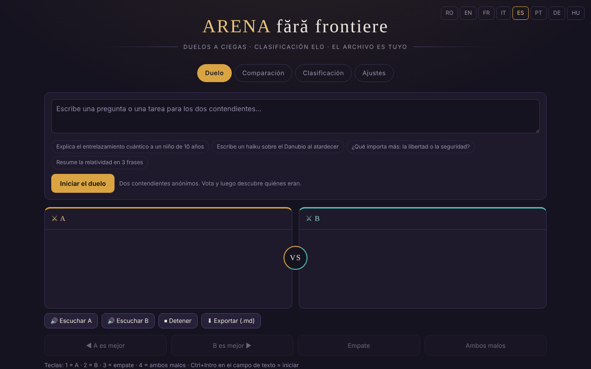

# Arena sin fronteras

[English](README.md) · [Română](README.ro.md) · [Français](README.fr.md) · [Italiano](README.it.md) · **Español** · [Português](README.pt.md) · [Deutsch](README.de.md) · [Magyar](README.hu.md)

**Versión:** 1.3.10 · **Última actualización:** 2026-10-26

Idiomas de la interfaz: **Română, English, Français, Italiano, Español, Português (PT), Deutsch, Magyar**

Duelos a ciegas entre modelos de IA, con clasificación Elo local — en un único archivo HTML.

**Aplicación en línea:** https://chiuta.github.io/ARENA/

## Qué es

ARENA es una aplicación de un único archivo (`index.html`, JavaScript puro) en la que comparas dos modelos de lenguaje sin saber cuál es cuál: envías el mismo prompt a dos «combatientes» anónimos, votas la mejor respuesta y luego la aplicación te muestra quiénes eran y actualiza una clasificación Elo. Los modelos pueden ser servicios en la nube (con tu clave API), servidores locales o motores en el navegador; también hay modelos de demostración que funcionan sin ninguna clave.

## Funciones

- Cuatro pestañas: **Duelo**, **Comparación**, **Clasificación**, **Ajustes**.
- Duelo a ciegas: botones «A es mejor», «B es mejor», «Empate», «Ambos malos»; tras la votación se revelan los modelos.
- Comparación: eliges tú los dos combatientes, sin voto y sin Elo.
- Clasificación Elo local (parte de 1000, K=32; el empate y «ambos malos» cuentan como tablas), con un botón «Restablecer la clasificación».
- Ajustes: añadir/editar/borrar modelos (nombre, proveedor, ID del modelo, Base URL, clave API), botón «Probar», «Probar todos los modelos activos».
- Tipos de proveedores: compatibles con OpenAI, Anthropic, Ollama (local), Pollinations (clave opcional), WebLLM (WebGPU), IA integrada en el navegador (Gemini Nano), Transformers.js, además de modelos de demostración.
- Un catálogo de IA integrables (con fecha del 29 de julio de 2026, 181 entradas, 68 proveedores según el texto de la aplicación; no reverificado a 11 de octubre de 2026, véase la nota de la aplicación), con filtros, «+ Añadir todos» y «⟳» para sincronizar la lista de modelos desde el proveedor.
- «Exportar todo (JSON)», «Importar», «Borrar todo».
- Atajos de teclado: `1` / `2` / `3` / `4` votan (A, B, empate, ambos malos) cuando no estás en un campo de texto; `Ctrl`/`Cmd`+`Intro` en el campo de texto inicia el duelo o la comparación.
- «Exportar la clasificación (CSV)» (en la pestaña Clasificación): archivo generado localmente; los nombres que empiezan por `=`, `+`, `-`, `@` se neutralizan.
- Opción en Ajustes: «Guardar las claves API solo durante la sesión» — las claves dejan de escribirse en `localStorage` (permanecen en `sessionStorage` y desaparecen al cerrar la pestaña).
- Interfaz en 8 idiomas (selector RO / EN / FR / IT / ES / PT / DE / HU en el encabezado; los combatientes de demostración responden en el idioma elegido; las notas por grupo del catálogo de IA permanecen en rumano).

## Manual de uso

1. Abre la pestaña **Ajustes** y añade al menos dos combatientes activos: pulsa «+ Añadir modelo», rellena el proveedor, el ID del modelo, la Base URL y la clave API, y luego «Guardar». También puedes usar los modelos de demostración, sin clave.
2. Pulsa «Probar» para comprobar un modelo o «⚡ Probar todos los modelos activos» (atención: cada prueba consume una llamada de la cuota del proveedor; la aplicación pide confirmación).
3. Ve a la pestaña **Duelo**, escribe la pregunta o la tarea y pulsa «Iniciar el duelo». «Detener» interrumpe la generación.
4. Lee las dos respuestas (A y B) y vota. Luego ves la identidad de los modelos y el resultado; «Duelo nuevo» inicia otro.
5. Pestaña **Comparación**: elige manualmente dos combatientes y pulsa «Comparar» para una comparación directa sin puntuación.
6. Pestaña **Clasificación**: consulta la puntuación Elo, el número de duelos y victorias/empates/derrotas; «Restablecer la clasificación» la vacía.
7. Copia de seguridad: en **Ajustes → Tus datos**, «Exportar todo (JSON)» guarda modelos, claves y clasificación; «Importar» los recarga. El archivo exportado contiene las claves API, guárdalo en lugar seguro.
8. Cambia el idioma desde el selector del encabezado.

## Privacidad y red

- **Almacenamiento local:** todos los datos (modelos, claves API, clasificación, historial) se guardan en `localStorage` bajo la clave `arena-ff-v1`. Las claves API pueden guardarse por separado, solo en `sessionStorage`, desde Ajustes. Si `localStorage` no está disponible, los datos se pierden al cerrar la página.
- **Red:** la aplicación no tiene servidor propio y no envía telemetría. Las solicitudes de chat salen directamente del navegador hacia el proveedor que configures (por ejemplo `api.openai.com`, `api.anthropic.com`, `gen.pollinations.ai`, `router.huggingface.co`, un servidor local `localhost`, etc.), con tu clave.
- **CDN:** solo si eliges los motores en el navegador, los módulos se cargan desde `vendor/` del mismo origen (`@mlc-ai/web-llm@0.2.84`, `@huggingface/transformers@4.2.0`, sin CDN); después se descargan la biblioteca de modelo de WebLLM (`.wasm`, commit de `binary-mlc-llm-libs` fijado, verificada con SRI SHA-256) o el `.wasm` de ONNX Runtime (URL de jsDelivr fijada, SHA-256 verificado, rechazado si difiere) y los pesos de los modelos (p. ej. de Hugging Face, sin hash fijado).
- **Modelos en la nube desactivados por defecto:** los modelos del catálogo que no piden clave (Kilo Gateway, `api.kilo.ai`: Kilo Auto, GLM-5, MiniMax M2.5, StepFun Step 3.5 Flash) se añaden a la lista pero **desactivados**; su activación (interruptor en **Ajustes**) exige una confirmación explícita, y solo entonces un duelo puede enviarles el prompt. En la primera ejecución tras esta versión, los modelos de este tipo que seguían activos de una versión anterior se desactivan una sola vez. Sin consentimiento, solo están activos los modelos de demostración (sin conexión).
- **Claves API:** por defecto se guardan en claro en `localStorage` (`arena-ff-v1`); con la opción «solo durante la sesión» (Ajustes → Tus datos) se guardan únicamente en `sessionStorage` (`arena-ff-v1-keys`) y no se escriben en disco, y al «Exportar todo» la aplicación pregunta si quieres incluir las claves (Cancelar = exportación sin claves). Cualquiera con acceso al perfil del navegador o que ejecute un script en este origen puede leerlas.
- Los enlaces del catálogo (documentaciones, consolas de claves) se abren solo al hacer clic.
- Los modelos de demostración no hacen ninguna llamada de red.

- **CSP:** la página tiene una política CSP: scripts solo en línea, mediante hash SHA-256 (sin `'unsafe-inline'`), además de `'self'` (los motores en el navegador vienen de `vendor/`), conexiones `https:`/`http:`/`ws:` (las direcciones base de los proveedores las configura el usuario, por lo que no pueden enumerarse), sin objetos, `base`/`form` bloqueados.

## Ejecución local / sin conexión

Descarga `index.html` y ábrelo en un navegador. Los modelos de demostración funcionan totalmente sin conexión. Los proveedores en la nube, la importación de los motores WebLLM/Transformers.js y la sincronización del catálogo requieren internet; Ollama u otro servidor local funciona con la red local, si el servidor acepta llamadas desde el navegador (CORS).

## Funciones nuevas (v1.1.0)

- **Lectura de las respuestas en voz alta** (botones «Escuchar A» / «Escuchar B» / «Detener», bajo el duelo y bajo la comparación; FFF.tts): usa la voz del sistema y el texto no sale del navegador. Si el navegador no tiene sintetizador, aparece un mensaje, no un error.
- **Exportación del duelo / comparación como Markdown** («Exportar (.md)»): la pregunta y las dos respuestas. Antes de votar, el duelo sigue siendo a ciegas: el archivo no contiene los nombres de los modelos y lo indica; tras la votación, los nombres se incluyen.
- **Etiqueta de transparencia y copia .fff.json** (kit común: core, label, bundle, tts): haz clic en `v 1.1.0 · 2026-10-14`. **Atención:** la copia contiene también las claves API guardadas en `localStorage`; usa «Cifrar con contraseña» o la opción existente «Guardar las claves API solo durante la sesión».
- Corregido: el contraste del color rojo de la puntuación negativa en los encabezados de los paneles (axe-core color-contrast).
- Los textos nuevos están en ro, en, fr, it, es, pt, hu, de; las traducciones fr/it/es/pt/hu/de son automáticas y no están verificadas por nativos (la interfaz existente sigue siendo ro/en/fr).
- Pruebas: `tests/fff-r8.test.mjs` (red bloqueada, 1280 y 360 px, axe 0 infracciones, duelo con modelos de demostración).

## Historial / Registro de cambios

### 1.3.6 — 2026-10-22
- Los motores en el navegador ya no dependen de un CDN: WebLLM 0.2.84 y Transformers.js 4.2.0 (con los cargadores de ONNX Runtime) están en `vendor/`. Las bibliotecas de modelo de WebLLM (`.wasm`) vienen de un commit fijado de `binary-mlc-llm-libs` y se verifican con SRI SHA-256; el `.wasm` de ONNX Runtime se verifica con SHA-256 antes de usarse (rechazado si difiere). La CSP quita `esm.run` y `cdn.jsdelivr.net` de `script-src`.
- La página ya no es un único archivo cuando usas estos motores (los motores están en `vendor/`, +6,4 MB). Nuevo `NOTICE.md`.

### 1.3.5 — 2026-10-22
- fff-kit 1.1.4: objetivos táctiles y tamaño mínimo de texto

### 1.3.4 — 2026-10-22
- fff-kit 1.1.2: PBKDF2 600 000 iteraciones, protección anti-clickjacking

### 1.3.2 — 2026-10-22
- La nota de privacidad sobre los modelos en la nube (Ajustes y Duelo) ahora aparece solo en el idioma actual de la interfaz, y no bilingüe rumano · inglés; traducida a fr, it, es, pt, de y hu.

### 1.3.1 — 2026-10-22
- El catálogo de proveedores en Ajustes (nombres de grupos, notas por proveedor, etiquetas de modelos, opciones de proveedor y códigos de error) ahora está traducido a los ocho idiomas en lugar de quedarse en rumano.

### 1.2.0 — 2026-10-18
- Seguridad: la exportación desde Ajustes YA NO incluye las claves API a menos que marques «Incluir las claves API…» y confirmes; la copia de seguridad sin cifrar del kit (1.1.0) vacía las claves (la cifrada con contraseña las conserva). La restauración de una copia sin cifrar ya no recupera las claves: se vuelven a introducir manualmente.

### 1.1.0 — 2026-10-14
- Novedad: lectura de las respuestas en voz alta, exportación del duelo/comparación a Markdown, etiqueta de transparencia y copia .fff.json (kit común); contraste corregido.

### 12 de octubre de 2026 (v1.0.0)
- 1.3.3 — 2026-10-22: Los seis window.confirm (reinicio, borrado de modelo, consentimiento cloud, exportación de claves, borrado de datos, prueba masiva) se sustituyen por diálogos integrados; el mensaje de importación JSON no válida está traducido; tamaño mínimo de texto 12 px.

- 1.0.0 — 2026-10-12: la versión y la fecha de la última actualización se muestran en la aplicación

### 11 de octubre de 2026 (tercera entrada)
- Interfaz en francés (≈110 textos, incluidos los combatientes de demostración y la nota del catálogo), junto al rumano y el inglés.
- Corregido: el texto de una notificación (toast) anterior permanecía en la región `aria-live` tras desaparecer; guardar un modelo sin nombre muestra ahora un mensaje y marca el campo `aria-invalid` (antes no ocurría nada visible).

### 11 de octubre de 2026 (segunda entrada)
- Seguridad: CSP con `script-src` por hash (sin `'unsafe-inline'`); opción «claves API solo durante la sesión».
- Atajos de teclado para votar e iniciar, exportación CSV de la clasificación; textos nuevos en rumano e inglés.

### 11 de octubre de 2026
- Accesibilidad: título `h1` añadido, selector de idioma como <nav> etiquetado (axe: 0 infracciones).
- Las respuestas de demostración llevan ahora una nota visible que indica que se generan a partir de una plantilla de estilo, no por un modelo real.
- El catálogo de IA: la nota de la aplicación (RO/EN) precisa que la última comprobación fue el 29 de julio de 2026 y que no se ha reverificado a 11 de octubre de 2026.
- CSP añadida (scripts solo en línea + esm.run/cdn.jsdelivr.net; sin objetos).

## Licencia

MIT para el código y la estructura de la aplicación — consulta el archivo `LICENSE`. Las posibles bibliotecas de terceros incluidas en el archivo conservan sus propias licencias.

## Autor

Alexio — Alexandru-Ionuț Chiuță, contacto: alexio@trom.tf.

## Resumen

ARENA es una aplicación HTML de un único archivo para duelos a ciegas cara a cara entre modelos de IA con una clasificación Elo local. Los modelos pueden ser API en la nube (tu propia clave), servidores locales (p. ej. Ollama) o motores en el navegador; los modelos de demostración funcionan sin conexión. Los datos permanecen en localStorage (`arena-ff-v1`); las solicitudes van directamente del navegador al proveedor que configures. Interfaz en 8 idiomas. Licencia: MIT (véase LICENSE).

Auditoría: 2026-10-10 (ronda 2: 2026-10-11, modelos en la nube desactivados por defecto, exportación con/sin claves) — verificado el código (solicitudes de red, saneamiento del estado importado, representación de las respuestas mediante textContent), la accesibilidad (axe: contraste corregido) y el funcionamiento (duelo con modelos de demostración, pestañas). Los motores en el navegador (WebLLM/Transformers.js) son opcionales y solo se cargan desde `vendor/` bajo petición.
