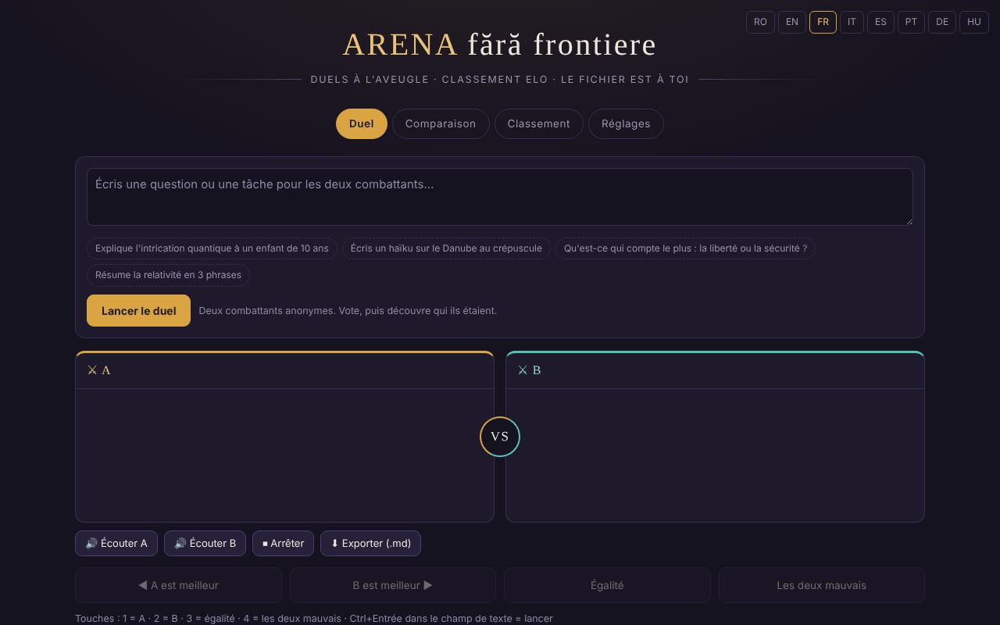

# Arena sans frontières

[English](README.md) · [Română](README.ro.md) · **Français** · [Italiano](README.it.md) · [Español](README.es.md) · [Português](README.pt.md) · [Deutsch](README.de.md) · [Magyar](README.hu.md)

**Version :** 2.0.0 · **Dernière mise à jour :** 2026-10-26

Langues de l'interface : **Română, English, Français, Italiano, Español, Português (PT), Deutsch, Magyar**

Duels à l'aveugle entre modèles d'IA, avec classement Elo local — dans un seul fichier HTML.

**Application en ligne :** https://chiuta.github.io/ARENA/

## Ce que c'est

ARENA est une application en un seul fichier (`index.html`, JavaScript natif) dans laquelle vous comparez deux modèles de langage sans savoir lequel est lequel : vous envoyez le même prompt à deux « combattants » anonymes, vous votez pour la meilleure réponse, puis l'application vous montre qui ils étaient et met à jour un classement Elo. Les modèles peuvent être des services cloud (avec votre clé API), des serveurs locaux ou des moteurs dans le navigateur ; il existe aussi des modèles de démonstration qui fonctionnent sans aucune clé.

## Fonctions

- **Evaluation (2.0):** prompt sets (one line = one prompt, optionally `category | prompt`), consecutive blind-duel sessions, per-category Elo leaderboard (recomputed from history) and an exportable JSON report (no API keys, no prompt texts). All local.
- Quatre onglets : **Duel**, **Comparaison**, **Classement**, **Paramètres**.
- Duel à l'aveugle : boutons « A est meilleur », « B est meilleur », « Égalité », « Les deux sont mauvais » ; après le vote, les modèles sont dévoilés.
- Comparaison : vous choisissez vous-même les deux combattants, sans vote et sans Elo.
- Classement Elo local (part de 1000, K=32 ; l'égalité et « les deux sont mauvais » comptent comme un match nul), avec un bouton « Réinitialiser le classement ».
- Paramètres : ajout/modification/suppression de modèles (nom, fournisseur, ID du modèle, Base URL, clé API), bouton « Tester », « Tester tous les modèles actifs ».
- Types de fournisseurs : compatibles OpenAI, Anthropic, Ollama (local), Pollinations (clé facultative), WebLLM (WebGPU), IA intégrée au navigateur (Gemini Nano), Transformers.js, plus des modèles de démonstration.
- Un catalogue d'IA intégrables (daté du 29 juillet 2026, 181 entrées, 68 fournisseurs d'après le texte de l'application ; non revérifié au 11 octobre 2026, voir la note dans l'application), avec filtres, « + Tout ajouter » et « ⟳ » pour synchroniser la liste des modèles auprès du fournisseur.
- « Tout exporter (JSON) », « Importer », « Tout supprimer ».
- Raccourcis clavier : `1` / `2` / `3` / `4` votent (A, B, égalité, les deux sont mauvais) lorsque vous n'êtes pas dans un champ de texte ; `Ctrl`/`Cmd`+`Entrée` dans le champ de texte lance le duel ou la comparaison.
- « Exporter le classement (CSV) » (dans l'onglet Classement) : fichier généré localement ; les noms commençant par `=`, `+`, `-`, `@` sont neutralisés.
- Option dans les Paramètres : « Conserver les clés API uniquement pour la session » — les clés ne sont plus écrites dans `localStorage` (elles restent dans `sessionStorage` et disparaissent à la fermeture de l'onglet).
- Interface en 8 langues (sélecteur RO / EN / FR / IT / ES / PT / DE / HU dans l'en-tête ; les combattants de démonstration répondent dans la langue choisie ; les notes par groupe du catalogue d'IA restent en roumain).

## Mode d'emploi

1. Ouvrez l'onglet **Paramètres** et ajoutez au moins deux combattants actifs : appuyez sur « + Ajouter un modèle », renseignez le fournisseur, l'ID du modèle, la Base URL et la clé API, puis « Enregistrer ». Vous pouvez aussi utiliser les modèles de démonstration, sans clé.
2. Appuyez sur « Tester » pour vérifier un modèle ou sur « ⚡ Tester tous les modèles actifs » (attention : chaque test consomme un appel du quota du fournisseur ; l'application demande confirmation).
3. Allez dans l'onglet **Duel**, écrivez la question ou la tâche et appuyez sur « Lancer le duel ». « Arrêter » interrompt la génération.
4. Lisez les deux réponses (A et B) et votez. Vous voyez ensuite l'identité des modèles et le résultat ; « Nouveau duel » en lance un autre.
5. Onglet **Comparaison** : choisissez manuellement deux combattants et appuyez sur « Comparer » pour une comparaison directe sans score.
6. Onglet **Classement** : consultez le score Elo, le nombre de duels et les victoires/nuls/défaites ; « Réinitialiser le classement » le vide.
7. Sauvegarde : dans **Paramètres → Vos données**, « Tout exporter (JSON) » enregistre les modèles, les clés et le classement ; « Importer » les recharge. Le fichier exporté contient les clés API, conservez-le en lieu sûr.
8. Changez la langue avec le sélecteur de l'en-tête.

## Confidentialité et réseau

- **Stockage local :** toutes les données (modèles, clés API, classement, historique) sont enregistrées dans `localStorage` sous la clé `arena-ff-v1`. Les clés API peuvent être conservées séparément, uniquement dans `sessionStorage`, depuis les Paramètres. Si `localStorage` n'est pas disponible, les données sont perdues à la fermeture de la page.
- **Réseau :** l'application n'a pas de serveur propre et n'envoie aucune télémétrie. Les requêtes de chat partent directement du navigateur vers le fournisseur que vous configurez (par exemple `api.openai.com`, `api.anthropic.com`, `gen.pollinations.ai`, `router.huggingface.co`, un serveur local `localhost`, etc.), avec votre clé.
- **CDN :** uniquement si vous choisissez les moteurs dans le navigateur, les modules sont chargés depuis `vendor/` de la même origine (`@mlc-ai/web-llm@0.2.84`, `@huggingface/transformers@4.2.0`, sans CDN) ; ensuite sont téléchargés la bibliothèque de modèle WebLLM (`.wasm`, commit `binary-mlc-llm-libs` figé, vérifiée par SRI SHA-256) ou le `.wasm` d'ONNX Runtime (URL jsDelivr figée, SHA-256 vérifié, refusé en cas de différence) et les poids des modèles (p. ex. depuis Hugging Face, sans empreinte figée).
- **Modèles cloud désactivés par défaut :** les modèles du catalogue qui ne demandent pas de clé (Kilo Gateway, `api.kilo.ai` : Kilo Auto, GLM-5, MiniMax M2.5, StepFun Step 3.5 Flash) sont ajoutés à la liste mais **désactivés** ; leur activation (interrupteur dans les **Paramètres**) exige une confirmation explicite, et ce n'est qu'ensuite qu'un duel peut leur envoyer le prompt. Lors du premier lancement après cette version, les modèles de ce type restés actifs depuis une version précédente sont désactivés une seule fois. Sans accord, seuls les modèles de démonstration (hors ligne) sont actifs.
- **Clés API :** par défaut elles sont conservées en clair dans `localStorage` (`arena-ff-v1`) ; avec l'option « uniquement pour la session » (Paramètres → Vos données) elles ne sont conservées que dans `sessionStorage` (`arena-ff-v1-keys`) et ne sont pas écrites sur le disque, et lors de « Tout exporter » l'application demande si vous voulez inclure les clés (Annuler = export sans clés). Toute personne ayant accès au profil du navigateur ou exécutant un script sur cette origine peut les lire.
- Les liens du catalogue (documentations, consoles de clés) ne s'ouvrent qu'au clic.
- Les modèles de démonstration ne font aucun appel réseau.

- **CSP :** la page a une politique CSP : scripts uniquement en ligne, par empreinte SHA-256 (sans `'unsafe-inline'`), plus `'self'` (les moteurs dans le navigateur viennent de `vendor/`), connexions `https:`/`http:`/`ws:` (les adresses de base des fournisseurs sont configurées par l'utilisateur, elles ne peuvent donc pas être énumérées), sans objets, `base`/`form` bloqués.

## Exécution locale / hors ligne

Téléchargez `index.html` et ouvrez-le dans un navigateur. Les modèles de démonstration fonctionnent entièrement hors ligne. Les fournisseurs cloud, l'import des moteurs WebLLM/Transformers.js et la synchronisation du catalogue exigent internet ; Ollama ou un autre serveur local fonctionne avec le réseau local, si le serveur accepte les appels du navigateur (CORS).

## Nouvelles fonctions (v1.1.0)

- **Lecture des réponses à voix haute** (boutons « Écouter A » / « Écouter B » / « Arrêter », sous le duel et sous la comparaison ; FFF.tts) : elle utilise la voix du système, et le texte ne quitte pas le navigateur. Si le navigateur n'a pas de synthétiseur, un message apparaît, pas une erreur.
- **Export du duel / de la comparaison en Markdown** (« Exporter (.md) ») : la question et les deux réponses. Avant le vote, le duel reste à l'aveugle : le fichier ne contient pas les noms des modèles et le précise ; après le vote, les noms sont inclus.
- **Étiquette de transparence et copie .fff.json** (kit commun : core, label, bundle, tts) : cliquez sur `v 1.1.0 · 2026-10-14`. **Attention :** la copie contient aussi les clés API enregistrées dans `localStorage` ; utilisez « Chiffrer par mot de passe » ou l'option existante « Conserver les clés API uniquement pour la session ».
- Corrigé : le contraste de la couleur rouge du score négatif dans les en-têtes de panneaux (axe-core color-contrast).
- Les nouveaux textes sont en ro, en, fr, it, es, pt, hu, de ; les traductions fr/it/es/pt/hu/de sont automatiques et non vérifiées par des natifs (l'interface existante reste ro/en/fr).
- Tests : `tests/fff-r8.test.mjs` (réseau bloqué, 1280 et 360 px, axe 0 violation, duel avec des modèles de démonstration).

## Historique / Journal des modifications

### 1.3.6 — 2026-10-22
- Les moteurs dans le navigateur ne dépendent plus d'un CDN : WebLLM 0.2.84 et Transformers.js 4.2.0 (avec les chargeurs ONNX Runtime) sont dans `vendor/`. Les bibliothèques de modèle WebLLM (`.wasm`) viennent d'un commit figé de `binary-mlc-llm-libs` et sont vérifiées par SRI SHA-256 ; le `.wasm` d'ONNX Runtime est vérifié par SHA-256 avant usage (refusé en cas de différence). La CSP retire `esm.run` et `cdn.jsdelivr.net` de `script-src`.
- La page n'est plus un fichier unique lorsque vous utilisez ces moteurs (les moteurs sont dans `vendor/`, +6,4 Mo). Nouveau `NOTICE.md`.

### 1.3.5 — 2026-10-22
- fff-kit 1.1.4 : cibles tactiles et taille de texte minimale

### 1.3.4 — 2026-10-22
- fff-kit 1.1.2 : PBKDF2 600 000 itérations, protection anti-clickjacking

### 1.3.2 — 2026-10-22
- La note de confidentialité sur les modèles cloud (Réglages et Duel) s’affiche désormais uniquement dans la langue de l’interface, et non plus en roumain · anglais ; traduite en fr, it, es, pt, de et hu.

### 1.3.1 — 2026-10-22
- Le catalogue des fournisseurs dans Réglages (noms de groupes, notes par fournisseur, étiquettes de modèles, options de fournisseur et codes d'erreur) est désormais traduit dans les huit langues au lieu de rester en roumain.

### 1.2.0 — 2026-10-18
- Sécurité : l'export depuis les Paramètres N'INCLUT PLUS les clés API sauf si vous cochez « Inclure les clés API… » et confirmez ; la copie de sauvegarde non chiffrée du kit (1.1.0) vide les clés (celle chiffrée par mot de passe les conserve). La restauration d'une copie non chiffrée ne ramène plus les clés : elles se saisissent manuellement.

### 1.1.0 — 2026-10-14
- Nouveau : lecture des réponses à voix haute, export du duel/de la comparaison en Markdown, étiquette de transparence et copie .fff.json (kit commun) ; contraste corrigé.

### 12 octobre 2026 (v1.0.0)
- 1.3.3 — 2026-10-22 : Les six window.confirm (réinitialisation, suppression de modèle, consentement cloud, export des clés, effacement des données, test groupé) sont remplacés par des boîtes de dialogue intégrées ; le message d’import JSON invalide est traduit ; taille de texte minimale 12 px.

- 1.0.0 — 2026-10-12 : la version et la date de la dernière mise à jour sont affichées dans l'application

### 11 octobre 2026 (troisième entrée)
- Interface en français (≈110 textes, y compris les combattants de démonstration et la note du catalogue), à côté du roumain et de l'anglais.
- Corrigé : le texte d'une notification (toast) précédente restait dans la région `aria-live` après sa disparition ; l'enregistrement d'un modèle sans nom affiche désormais un message et marque le champ `aria-invalid` (auparavant rien de visible ne se produisait).

### 11 octobre 2026 (deuxième entrée)
- Sécurité : CSP avec `script-src` par empreinte (sans `'unsafe-inline'`) ; option « clés API uniquement pour la session ».
- Raccourcis clavier pour voter et lancer, export CSV du classement ; nouveaux textes en roumain et en anglais.

### 11 octobre 2026
- Accessibilité : titre `h1` ajouté, sélecteur de langue sous forme de <nav> étiquetée (axe : 0 violation).
- Les réponses de démonstration portent désormais une note visible indiquant qu'elles sont générées à partir d'un modèle de style, et non par un vrai modèle.
- Le catalogue d'IA : la note dans l'application (RO/EN) précise que la dernière vérification date du 29 juillet 2026 et qu'il n'a pas été revérifié au 11 octobre 2026.
- CSP ajoutée (scripts uniquement en ligne + esm.run/cdn.jsdelivr.net ; sans objets).

## Licence

MIT pour le code et la structure de l'application — voir le fichier `LICENSE`. Les éventuelles bibliothèques tierces incluses dans le fichier conservent leurs propres licences.

## Auteur

Alexio — Alexandru-Ionuț Chiuță, contact : alexio@trom.tf.

## Résumé

ARENA est une application HTML en un seul fichier pour des duels à l'aveugle en face-à-face entre modèles d'IA, avec un classement Elo local. Les modèles peuvent être des API cloud (votre propre clé), des serveurs locaux (p. ex. Ollama) ou des moteurs dans le navigateur ; les modèles de démonstration fonctionnent hors ligne. Les données restent dans localStorage (`arena-ff-v1`) ; les requêtes vont directement du navigateur vers le fournisseur que vous configurez. Interface en 8 langues. Licence : MIT (voir LICENSE).

Audit : 2026-10-10 (tour 2 : 2026-10-11, modèles cloud désactivés par défaut, export avec/sans clés) — vérification du code (requêtes réseau, assainissement de l'état importé, affichage des réponses via textContent), de l'accessibilité (axe : contraste corrigé) et du fonctionnement (duel avec modèles de démonstration, onglets). Les moteurs dans le navigateur (WebLLM/Transformers.js) sont facultatifs et ne sont chargés depuis `vendor/` que sur demande.
