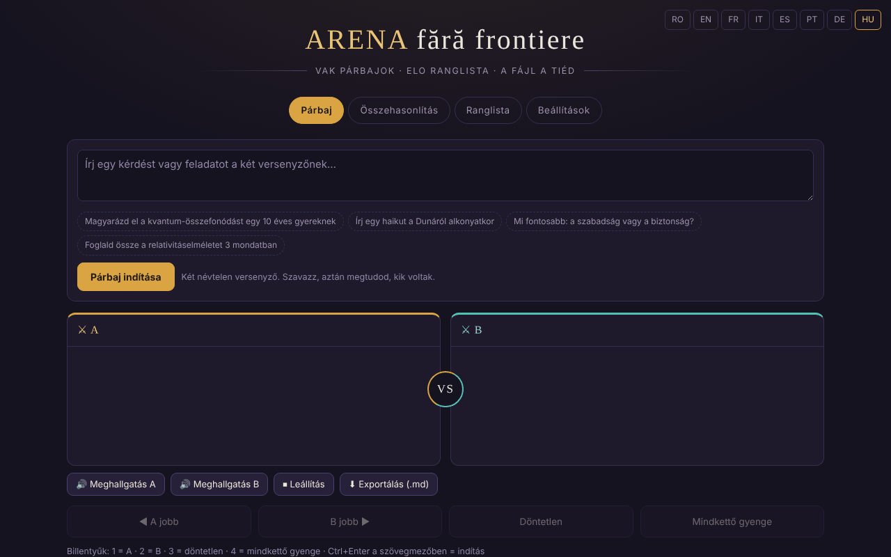

# Aréna határok nélkül

[English](README.md) · [Română](README.ro.md) · [Français](README.fr.md) · [Italiano](README.it.md) · [Español](README.es.md) · [Português](README.pt.md) · [Deutsch](README.de.md) · **Magyar**

**Verzió:** 1.3.10 · **Utolsó frissítés:** 2026-10-26

A felület nyelvei: **Română, English, Français, Italiano, Español, Português (PT), Deutsch, Magyar**

Vak párbajok MI-modellek között, helyi Elo-ranglistával — egyetlen HTML-fájlban.

**Online alkalmazás:** https://chiuta.github.io/ARENA/

## Mi ez

Az ARENA egyfájlos alkalmazás (`index.html`, vanília JavaScript), amelyben két nyelvi modellt hasonlítasz össze anélkül, hogy tudnád, melyik melyik: ugyanazt a promptot elküldöd két névtelen „harcosnak”, megszavazod a jobb választ, majd az alkalmazás megmutatja, kik voltak, és frissít egy Elo-ranglistát. A modellek lehetnek felhőszolgáltatások (a saját API-kulcsoddal), helyi szerverek vagy böngészőbeli motorok; vannak demómodellek is, amelyek kulcs nélkül működnek.

## Funkciók

- Négy lap: **Párbaj**, **Összehasonlítás**, **Ranglista**, **Beállítások**.
- Vak párbaj: „A jobb”, „B jobb”, „Döntetlen”, „Mindkettő gyenge” gombok; a szavazás után a modellek felfedésre kerülnek.
- Összehasonlítás: te választod ki a két harcost, szavazás és Elo nélkül.
- Helyi Elo-ranglista (1000-ről indul, K=32; a döntetlen és a „mindkettő gyenge” döntetlennek számít), „Ranglista visszaállítása” gombbal.
- Beállítások: modellek hozzáadása/szerkesztése/törlése (név, szolgáltató, modellazonosító, Base URL, API-kulcs), „Teszt” gomb, „Az összes aktív modell tesztelése”.
- Szolgáltatótípusok: OpenAI-kompatibilis, Anthropic, Ollama (helyi), Pollinations (opcionális kulcs), WebLLM (WebGPU), a böngészőbe épített MI (Gemini Nano), Transformers.js, valamint demómodellek.
- Beépíthető MI-k katalógusa (2026. július 29-i dátummal, 181 bejegyzés, az alkalmazásbeli szöveg szerint 68 szolgáltató; 2026. október 11-én nem ellenőrizték újra, lásd az alkalmazásbeli megjegyzést), szűrőkkel, „+ Összes hozzáadása” és „⟳” gombbal a modelllista szinkronizálásához a szolgáltatótól.
- „Minden exportálása (JSON)”, „Importálás”, „Minden törlése”.
- Gyorsbillentyűk: az `1` / `2` / `3` / `4` szavaz (A, B, döntetlen, mindkettő gyenge), ha nem szövegmezőben vagy; a `Ctrl`/`Cmd`+`Enter` a szövegmezőben elindítja a párbajt vagy az összehasonlítást.
- „Ranglista exportálása (CSV)” (a Ranglista lapon): helyben generált fájl; az `=`, `+`, `-`, `@` karakterrel kezdődő neveket semlegesíti.
- Beállítás a Beállításokban: „Az API-kulcsok megőrzése csak a munkamenetben” — a kulcsok többé nem íródnak a `localStorage`-ba (a `sessionStorage`-ban maradnak, és a lap bezárásakor eltűnnek).
- Felület 8 nyelven (RO / EN / FR / IT / ES / PT / DE / HU választó a fejlécben; a demóharcosok a választott nyelven válaszolnak; az MI-katalógus csoportonkénti megjegyzései románul maradnak).

## Használati útmutató

1. Nyisd meg a **Beállítások** lapot, és adj hozzá legalább két aktív harcost: nyomd meg a „+ Modell hozzáadása” gombot, töltsd ki a szolgáltatót, a modellazonosítót, a Base URL-t és az API-kulcsot, majd „Mentés”. Használhatod a demómodelleket is, kulcs nélkül.
2. Nyomd meg a „Teszt” gombot egy modell ellenőrzéséhez, vagy a „⚡ Az összes aktív modell tesztelése” gombot (figyelem: minden teszt elhasznál egy hívást a szolgáltató kvótájából; az alkalmazás megerősítést kér).
3. Menj a **Párbaj** lapra, írd be a kérdést vagy a feladatot, és nyomd meg a „Párbaj indítása” gombot. A „Leállítás” megszakítja a generálást.
4. Olvasd el a két választ (A és B), és szavazz. Ezután látod a modellek kilétét és az eredményt; az „Új párbaj” újat indít.
5. **Összehasonlítás** lap: válassz ki kézzel két harcost, és nyomd meg az „Összehasonlítás” gombot a pontszám nélküli közvetlen összehasonlításhoz.
6. **Ranglista** lap: nézd meg az Elo-pontszámot, a párbajok számát és a győzelmeket/döntetleneket/vereségeket; a „Ranglista visszaállítása” kiüríti.
7. Biztonsági mentés: a **Beállítások → Az adataid** alatt a „Minden exportálása (JSON)” menti a modelleket, kulcsokat és a ranglistát; az „Importálás” visszatölti őket. Az exportált fájl tartalmazza az API-kulcsokat, tartsd biztonságban.
8. A nyelvet a fejlécben lévő választóval válthatod.

## Adatvédelem és hálózat

- **Helyi tárolás:** minden adat (modellek, API-kulcsok, ranglista, előzmények) a `localStorage`-ban kerül mentésre az `arena-ff-v1` kulcs alatt. Az API-kulcsok a Beállításokból külön, csak a `sessionStorage`-ban is tarthatók. Ha a `localStorage` nem érhető el, az adatok az oldal bezárásakor elvesznek.
- **Hálózat:** az alkalmazásnak nincs saját szervere, és nem küld telemetriát. A csevegési kérések közvetlenül a böngészőből mennek az általad beállított szolgáltatóhoz (például `api.openai.com`, `api.anthropic.com`, `gen.pollinations.ai`, `router.huggingface.co`, egy helyi `localhost` szerver stb.), a te kulcsoddal.
- **CDN:** csak ha a böngészőbeli motorokat választod, a modulok ugyanazon eredet `vendor/` mappájából töltődnek be (`@mlc-ai/web-llm@0.2.84`, `@huggingface/transformers@4.2.0`, CDN nélkül); ezután letöltődik a WebLLM modellkönyvtára (`.wasm`, rögzített `binary-mlc-llm-libs` commit, SHA-256 SRI-vel ellenőrizve) vagy az ONNX Runtime `.wasm` (rögzített jsDelivr URL, SHA-256-tal ellenőrizve, eltérésnél elutasítva), valamint a modellsúlyok (pl. a Hugging Face-ről, rögzített ellenőrzőösszeg nélkül).
- **Alapértelmezés szerint kikapcsolt felhőmodellek:** a katalógus azon modelljei, amelyek nem kérnek kulcsot (Kilo Gateway, `api.kilo.ai`: Kilo Auto, GLM-5, MiniMax M2.5, StepFun Step 3.5 Flash) bekerülnek a listába, de **kikapcsolva**; bekapcsolásuk (kapcsoló a **Beállításokban**) kifejezett megerősítést igényel, és csak ezután küldheti el nekik egy párbaj a promptot. Az e verzió utáni első futtatáskor az előző verzióból aktívan maradt ilyen modelleket egyszer kikapcsolja. Hozzájárulás nélkül csak a demómodellek (offline) aktívak.
- **API-kulcsok:** alapértelmezés szerint egyszerű szövegként tárolódnak a `localStorage`-ban (`arena-ff-v1`); a „csak a munkamenetben” beállítással (Beállítások → Az adataid) csak a `sessionStorage`-ban (`arena-ff-v1-keys`) tárolódnak, és nem íródnak lemezre, a „Minden exportálása” során pedig az alkalmazás megkérdezi, hogy szeretnéd-e belefoglalni a kulcsokat (Mégse = export kulcsok nélkül). Bárki elolvashatja őket, aki hozzáfér a böngészőprofilhoz vagy szkriptet futtat ezen az origin-en.
- A katalógus hivatkozásai (dokumentációk, kulcskonzolok) csak kattintásra nyílnak meg.
- A demómodellek nem végeznek hálózati hívást.

- **CSP:** az oldalnak CSP-szabályzata van: szkriptek csak beágyazottan, SHA-256 ellenőrzőösszeggel (`'unsafe-inline'` nélkül), valamint `'self'` (a böngészőbeli motorok a `vendor/` mappából jönnek), `https:`/`http:`/`ws:` kapcsolatok (a szolgáltatók alapcímeit a felhasználó állítja be, ezért nem sorolhatók fel), objektumok nélkül, `base`/`form` letiltva.

## Helyi futtatás / offline

Töltsd le az `index.html` fájlt, és nyisd meg böngészőben. A demómodellek teljesen offline működnek. A felhőszolgáltatókhoz, a WebLLM/Transformers.js motorok importálásához és a katalógus szinkronizálásához internet kell; az Ollama vagy más helyi szerver a helyi hálózaton működik, ha a szerver fogad hívásokat a böngészőből (CORS).

## Új funkciók (v1.1.0)

- **A válaszok felolvasása** („A meghallgatása” / „B meghallgatása” / „Leállítás” gombok a párbaj és az összehasonlítás alatt; FFF.tts): a rendszerhangot használja, és a szöveg nem hagyja el a böngészőt. Ha a böngészőnek nincs szintetizátora, üzenet jelenik meg, nem hiba.
- **A párbaj / összehasonlítás exportálása Markdownba** („Exportálás (.md)”): a kérdés és a két válasz. A szavazás előtt a párbaj vak marad: a fájl nem tartalmazza a modellek nevét, és ezt jelzi; a szavazás után a nevek bekerülnek.
- **Átláthatósági címke és `.fff.json` másolat** (közös készlet: core, label, bundle, tts): kattints a `v 1.1.0 · 2026-10-14` feliratra. **Figyelem:** a másolat a `localStorage`-ban mentett API-kulcsokat is tartalmazza; használd a „Titkosítás jelszóval” lehetőséget vagy a meglévő „Az API-kulcsok megőrzése csak a munkamenetben” beállítást.
- Javítva: a negatív pontszám piros színének kontrasztja a panelek fejlécében (axe-core color-contrast).
- Az új szövegek ro, en, fr, it, es, pt, hu, de nyelven vannak; az fr/it/es/pt/hu/de fordítások automatikusak és anyanyelvi beszélő nem ellenőrizte őket (a meglévő felület ro/en/fr marad).
- Tesztek: `tests/fff-r8.test.mjs` (hálózat letiltva, 1280 és 360 px, axe 0 szabálysértés, párbaj demómodellekkel).

## Előzmények / Változásnapló

### 1.3.6 — 2026-10-22
- A böngészőbeli motorok már nem függenek CDN-től: a WebLLM 0.2.84 és a Transformers.js 4.2.0 (az ONNX Runtime betöltőkkel) a `vendor/` mappában van. A WebLLM modellkönyvtárai (`.wasm`) a `binary-mlc-llm-libs` egy rögzített commitjáról jönnek, és SHA-256 SRI-vel ellenőrzöttek; az ONNX Runtime `.wasm` használat előtt SHA-256-tal ellenőrzött (eltérésnél elutasítva). A CSP kivette az `esm.run` és a `cdn.jsdelivr.net` címet a `script-src`-ből.
- Az oldal e motorok használatakor már nem egyetlen fájl (a motorok a `vendor/` mappában vannak, +6,4 MB). Új `NOTICE.md`.

### 1.3.5 — 2026-10-22
- fff-kit 1.1.4: érintési célpontok és minimális szövegméret

### 1.3.4 — 2026-10-22
- fff-kit 1.1.2: PBKDF2 600 000 iteráció, clickjacking elleni védelem

### 1.3.2 — 2026-10-22
- A felhőmodellek adatvédelmi megjegyzése (Beállítások és Párbaj) mostantól csak az aktuális felületi nyelven jelenik meg, nem kétnyelvű román · angol szöveggel; fordítás: fr, it, es, pt, de, hu.

### 1.3.1 — 2026-10-22
- A Beállítások szolgáltatókatalógusa (csoportnevek, szolgáltatónkénti megjegyzések, modellcímkék, szolgáltatóopciók és hibakódok) mostantól mind a nyolc nyelven le van fordítva, nem marad románul.

### 1.2.0 — 2026-10-18
- Biztonság: a Beállításokból történő export MÁR NEM tartalmazza az API-kulcsokat, hacsak be nem jelölöd az „API-kulcsok belefoglalása…” lehetőséget, és meg nem erősíted; a készlet (1.1.0) titkosítatlan biztonsági másolata kiüríti a kulcsokat (a jelszóval titkosított megtartja őket). Egy titkosítatlan másolat visszaállítása már nem hozza vissza a kulcsokat: azokat kézzel kell újra megadni.

### 1.1.0 — 2026-10-14
- Új: a válaszok felolvasása, a párbaj/összehasonlítás exportálása Markdownba, átláthatósági címke és `.fff.json` másolat (közös készlet); kontraszt javítva.

### 2026. október 12. (v1.0.0)
- 1.3.3 — 2026-10-22: A hat window.confirm (visszaállítás, modell törlése, felhő-hozzájárulás, kulcsexport, adattörlés, tömeges teszt) oldalon belüli párbeszédpanelre cserélve; az érvénytelen JSON-importról szóló üzenet lefordítva; a szöveg minimális mérete 12 px.

- 1.0.0 — 2026-10-12: a verzió és az utolsó frissítés dátuma megjelenik az alkalmazásban

### 2026. október 11. (harmadik bejegyzés)
- Felület franciául (≈110 szöveg, a demóharcosokat és a katalógus megjegyzését is beleértve), a román és az angol mellett.
- Javítva: egy korábbi értesítés (toast) szövege eltűnése után is az `aria-live` régióban maradt; egy név nélküli modell mentése mostantól üzenetet jelenít meg, és `aria-invalid` jelölést tesz a mezőre (korábban semmi látható nem történt).

### 2026. október 11. (második bejegyzés)
- Biztonság: CSP ellenőrzőösszeg alapú `script-src`-vel (`'unsafe-inline'` nélkül); az „API-kulcsok csak a munkamenetben” beállítás.
- Gyorsbillentyűk a szavazáshoz és az indításhoz, a ranglista CSV-exportja; új szövegek románul és angolul.

### 2026. október 11.
- Hozzáférhetőség: `h1` címsor hozzáadva, a nyelvválasztó címkézett <nav> elemként (axe: 0 szabálysértés).
- A demóválaszok mostantól látható megjegyzést viselnek arról, hogy stílussablonból generáltak, nem valódi modell.
- Az MI-katalógus: az alkalmazásbeli megjegyzés (RO/EN) rögzíti, hogy az utolsó ellenőrzés 2026. július 29-én történt, és 2026. október 11-én nem ellenőrizték újra.
- CSP hozzáadva (szkriptek csak beágyazottan + esm.run/cdn.jsdelivr.net; objektumok nélkül).

## Licenc

MIT az alkalmazás kódjára és szerkezetére — lásd a `LICENSE` fájlt. A fájlba foglalt esetleges harmadik féltől származó könyvtárak megtartják saját licenceiket.

## Szerző

Alexio — Alexandru-Ionuț Chiuță, kapcsolat: alexio@trom.tf.

## Összefoglaló

Az ARENA egy egyfájlos HTML-alkalmazás MI-modellek közötti vak, közvetlen párbajokhoz helyi Elo-ranglistával. A modellek lehetnek felhős API-k (saját kulccsal), helyi szerverek (pl. Ollama) vagy böngészőbeli motorok; a demómodellek offline működnek. Az adatok a localStorage-ban maradnak (`arena-ff-v1`); a kérések közvetlenül a böngészőből mennek az általad beállított szolgáltatóhoz. Román és angol nyelvű felület. Licenc: MIT (lásd LICENSE).

Audit: 2026-10-10 (2. forduló: 2026-10-11, alapértelmezés szerint kikapcsolt felhőmodellek, export kulcsokkal/kulcsok nélkül) — ellenőrizve a kód (hálózati kérések, az importált állapot szanálása, a válaszok megjelenítése textContent-en keresztül), a hozzáférhetőség (axe: kontraszt javítva) és a működés (párbaj demómodellekkel, lapok). A böngészőbeli motorok (WebLLM/Transformers.js) opcionálisak, és csak kérésre töltődnek be a `vendor/` mappából.
