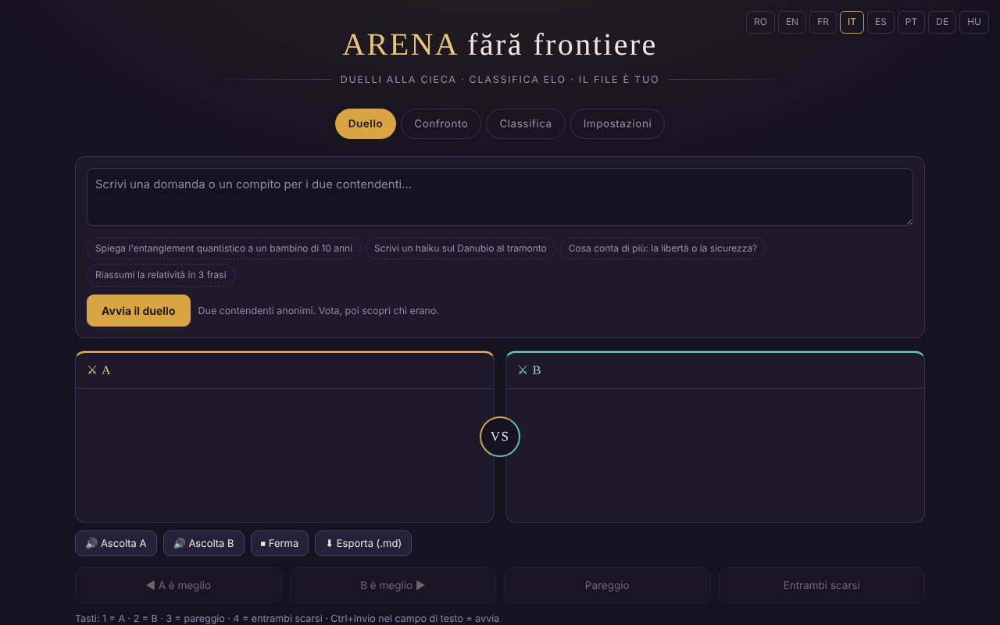

# Arena senza frontiere

[English](README.md) · [Română](README.ro.md) · [Français](README.fr.md) · **Italiano** · [Español](README.es.md) · [Português](README.pt.md) · [Deutsch](README.de.md) · [Magyar](README.hu.md)

**Versione:** 1.3.0 · **Ultimo aggiornamento:** 2026-10-19

Lingue dell'interfaccia: **Română, English, Français, Italiano, Español, Português (PT), Deutsch, Magyar**

Duelli alla cieca tra modelli di IA, con classifica Elo locale — in un unico file HTML.

**Applicazione online:** https://chiuta.github.io/ARENA/

## Che cos'è

ARENA è un'applicazione in un unico file (`index.html`, JavaScript puro) in cui confronti due modelli linguistici senza sapere quale sia quale: invii lo stesso prompt a due «combattenti» anonimi, voti la risposta migliore, poi l'applicazione ti mostra chi erano e aggiorna una classifica Elo. I modelli possono essere servizi cloud (con la tua chiave API), server locali o motori nel browser; esistono anche modelli dimostrativi che funzionano senza alcuna chiave.

## Funzioni

- Quattro schede: **Duello**, **Confronto**, **Classifica**, **Impostazioni**.
- Duello alla cieca: pulsanti «A è meglio», «B è meglio», «Pareggio», «Entrambi scarsi»; dopo il voto i modelli vengono svelati.
- Confronto: scegli tu i due combattenti, senza voto e senza Elo.
- Classifica Elo locale (parte da 1000, K=32; il pareggio e «entrambi scarsi» contano come patta), con un pulsante «Reimposta la classifica».
- Impostazioni: aggiunta/modifica/eliminazione di modelli (nome, provider, ID del modello, Base URL, chiave API), pulsante «Prova», «Prova tutti i modelli attivi».
- Tipi di provider: compatibili OpenAI, Anthropic, Ollama (locale), Pollinations (chiave facoltativa), WebLLM (WebGPU), IA integrata nel browser (Gemini Nano), Transformers.js, più modelli dimostrativi.
- Un catalogo di IA integrabili (datato 29 luglio 2026, 181 voci, 68 provider secondo il testo nell'applicazione; non riverificato all'11 ottobre 2026, vedi la nota nell'applicazione), con filtri, «+ Aggiungi tutti» e «⟳» per sincronizzare l'elenco dei modelli dal provider.
- «Esporta tutto (JSON)», «Importa», «Elimina tutto».
- Scorciatoie da tastiera: `1` / `2` / `3` / `4` votano (A, B, pareggio, entrambi scarsi) quando non sei in un campo di testo; `Ctrl`/`Cmd`+`Invio` nel campo di testo avvia il duello o il confronto.
- «Esporta la classifica (CSV)» (nella scheda Classifica): file generato localmente; i nomi che iniziano con `=`, `+`, `-`, `@` vengono neutralizzati.
- Opzione nelle Impostazioni: «Conserva le chiavi API solo per la sessione» — le chiavi non vengono più scritte in `localStorage` (restano in `sessionStorage` e scompaiono alla chiusura della scheda).
- Interfaccia in 8 lingue (selettore RO / EN / FR / IT / ES / PT / DE / HU nell'intestazione; i combattenti dimostrativi rispondono nella lingua scelta; le note per gruppo del catalogo di IA restano in rumeno).

## Guida all'uso

1. Apri la scheda **Impostazioni** e aggiungi almeno due combattenti attivi: premi «+ Aggiungi modello», compila il provider, l'ID del modello, la Base URL e la chiave API, poi «Salva». Puoi usare anche i modelli dimostrativi, senza chiave.
2. Premi «Prova» per verificare un modello o «⚡ Prova tutti i modelli attivi» (attenzione: ogni prova consuma una chiamata della quota del provider; l'applicazione chiede conferma).
3. Vai alla scheda **Duello**, scrivi la domanda o il compito e premi «Avvia il duello». «Interrompi» ferma la generazione.
4. Leggi le due risposte (A e B) e vota. Poi vedi l'identità dei modelli e il risultato; «Nuovo duello» ne avvia un altro.
5. Scheda **Confronto**: scegli manualmente due combattenti e premi «Confronta» per un confronto diretto senza punteggio.
6. Scheda **Classifica**: vedi il punteggio Elo, il numero di duelli e vittorie/pareggi/sconfitte; «Reimposta la classifica» la svuota.
7. Backup: in **Impostazioni → I tuoi dati**, «Esporta tutto (JSON)» salva modelli, chiavi e classifica; «Importa» li ricarica. Il file esportato contiene le chiavi API, conservalo in sicurezza.
8. Cambia la lingua dal selettore nell'intestazione.

## Riservatezza e rete

- **Archiviazione locale:** tutti i dati (modelli, chiavi API, classifica, cronologia) vengono salvati in `localStorage` con la chiave `arena-ff-v1`. Le chiavi API possono essere conservate separatamente, solo in `sessionStorage`, dalle Impostazioni. Se `localStorage` non è disponibile, i dati si perdono alla chiusura della pagina.
- **Rete:** l'applicazione non ha un server proprio e non invia telemetria. Le richieste di chat partono direttamente dal browser verso il provider che configuri (ad esempio `api.openai.com`, `api.anthropic.com`, `gen.pollinations.ai`, `router.huggingface.co`, un server locale `localhost` ecc.), con la tua chiave.
- **CDN:** solo se scegli i motori nel browser, i moduli vengono importati da `esm.run` (`@mlc-ai/web-llm@0.2.84`, `@huggingface/transformers@4.2.0`) e poi si scaricano i pesi dei modelli (ad es. da Hugging Face).
- **Modelli cloud disattivati per impostazione predefinita:** i modelli del catalogo che non richiedono una chiave (Kilo Gateway, `api.kilo.ai`: Kilo Auto, GLM-5, MiniMax M2.5, StepFun Step 3.5 Flash) vengono aggiunti all'elenco ma **disattivati**; la loro attivazione (interruttore nelle **Impostazioni**) richiede una conferma esplicita, e solo dopo un duello può inviare loro il prompt. Al primo avvio dopo questa versione, i modelli di questo tipo rimasti attivi da una versione precedente vengono disattivati una sola volta. Senza consenso, sono attivi solo i modelli dimostrativi (offline).
- **Chiavi API:** per impostazione predefinita vengono conservate in chiaro in `localStorage` (`arena-ff-v1`); con l'opzione «solo per la sessione» (Impostazioni → I tuoi dati) vengono conservate solo in `sessionStorage` (`arena-ff-v1-keys`) e non vengono scritte su disco, e con «Esporta tutto» l'applicazione chiede se vuoi includere le chiavi (Annulla = esportazione senza chiavi). Chiunque abbia accesso al profilo del browser o esegua script su questa origine può leggerle.
- I link del catalogo (documentazioni, console delle chiavi) si aprono solo al clic.
- I modelli dimostrativi non effettuano alcuna chiamata di rete.

- **CSP:** la pagina ha una politica CSP: script solo inline, tramite hash SHA-256 (senza `'unsafe-inline'`), più `esm.run`/`cdn.jsdelivr.net` (motori nel browser), connessioni `https:`/`http:`/`ws:` (gli indirizzi di base dei provider sono configurati dall'utente, quindi non possono essere elencati), senza oggetti, `base`/`form` bloccati.

## Esecuzione locale / offline

Scarica `index.html` e aprilo in un browser. I modelli dimostrativi funzionano completamente offline. I provider cloud, l'importazione dei motori WebLLM/Transformers.js e la sincronizzazione del catalogo richiedono internet; Ollama o un altro server locale funziona con la rete locale, se il server accetta chiamate dal browser (CORS).

## Nuove funzioni (v1.1.0)

- **Lettura delle risposte ad alta voce** (pulsanti «Ascolta A» / «Ascolta B» / «Interrompi», sotto il duello e sotto il confronto; FFF.tts): usa la voce di sistema e il testo non lascia il browser. Se il browser non ha un sintetizzatore, compare un messaggio, non un errore.
- **Esportazione del duello / confronto come Markdown** («Esporta (.md)»): la domanda e le due risposte. Prima del voto il duello resta alla cieca: il file non contiene i nomi dei modelli e lo dichiara; dopo il voto i nomi sono inclusi.
- **Etichetta di trasparenza e copia .fff.json** (kit comune: core, label, bundle, tts): clic su `v 1.1.0 · 2026-10-14`. **Attenzione:** la copia contiene anche le chiavi API salvate in `localStorage`; usa «Cifra con password» o l'opzione esistente «Conserva le chiavi API solo per la sessione».
- Corretto: il contrasto del colore rosso del punteggio negativo nelle intestazioni dei pannelli (axe-core color-contrast).
- I nuovi testi sono in ro, en, fr, it, es, pt, hu, de; le traduzioni fr/it/es/pt/hu/de sono automatiche e non verificate da madrelingua (l'interfaccia esistente resta ro/en/fr).
- Test: `tests/fff-r8.test.mjs` (rete bloccata, 1280 e 360 px, axe 0 violazioni, duello con modelli dimostrativi).

## Cronologia / Changelog

### 1.2.0 — 2026-10-18
- Sicurezza: l'esportazione dalle Impostazioni NON include più le chiavi API a meno che tu non selezioni «Includi le chiavi API…» e confermi; la copia di riserva non cifrata del kit (1.1.0) svuota le chiavi (quella cifrata con password le conserva). Il ripristino di una copia non cifrata non riporta più le chiavi: si reinseriscono manualmente.

### 1.1.0 — 2026-10-14
- Novità: lettura ad alta voce delle risposte, esportazione del duello/confronto in Markdown, etichetta di trasparenza e copia .fff.json (kit comune); contrasto corretto.

### 12 ottobre 2026 (v1.0.0)
- 1.0.0 — 2026-10-12: la versione e la data dell'ultimo aggiornamento sono mostrate nell'applicazione

### 11 ottobre 2026 (terza voce)
- Interfaccia in francese (≈110 testi, inclusi i combattenti dimostrativi e la nota del catalogo), accanto al rumeno e all'inglese.
- Corretto: il testo di una notifica (toast) precedente restava nella regione `aria-live` dopo la sua scomparsa; il salvataggio di un modello senza nome mostra ora un messaggio e contrassegna il campo `aria-invalid` (prima non succedeva nulla di visibile).

### 11 ottobre 2026 (seconda voce)
- Sicurezza: CSP con `script-src` tramite hash (senza `'unsafe-inline'`); opzione «chiavi API solo per la sessione».
- Scorciatoie da tastiera per votare e avviare, esportazione CSV della classifica; nuovi testi in rumeno e inglese.

### 11 ottobre 2026
- Accessibilità: titolo `h1` aggiunto, selettore della lingua come <nav> etichettato (axe: 0 violazioni).
- Le risposte dimostrative riportano ora una nota visibile che indica che sono generate da un modello di stile, non da un modello reale.
- Il catalogo di IA: la nota nell'applicazione (RO/EN) precisa che l'ultima verifica risale al 29 luglio 2026 e che non è stato riverificato all'11 ottobre 2026.
- Aggiunta la CSP (script solo inline + esm.run/cdn.jsdelivr.net; senza oggetti).

## Licenza

MIT per il codice e la struttura dell'applicazione — vedi il file `LICENSE`. Le eventuali librerie di terze parti incluse nel file mantengono le proprie licenze.

## Autore

Alexio — Alexandru-Ionuț Chiuță, contatto: alexio@trom.tf.

## Riepilogo

ARENA è un'applicazione HTML in un unico file per duelli alla cieca testa a testa tra modelli di IA con una classifica Elo locale. I modelli possono essere API cloud (la tua chiave), server locali (ad es. Ollama) o motori nel browser; i modelli dimostrativi funzionano offline. I dati restano in localStorage (`arena-ff-v1`); le richieste vanno direttamente dal browser al provider che configuri. Interfaccia in 8 lingue. Licenza: MIT (vedi LICENSE).

Audit: 2026-10-10 (round 2: 2026-10-11, modelli cloud disattivati per impostazione predefinita, esportazione con/senza chiavi) — verificati il codice (richieste di rete, sanificazione dello stato importato, resa delle risposte tramite textContent), l'accessibilità (axe: contrasto corretto) e il funzionamento (duello con modelli dimostrativi, schede). I motori nel browser (WebLLM/Transformers.js) sono facoltativi e vengono caricati da esm.run solo su richiesta.
