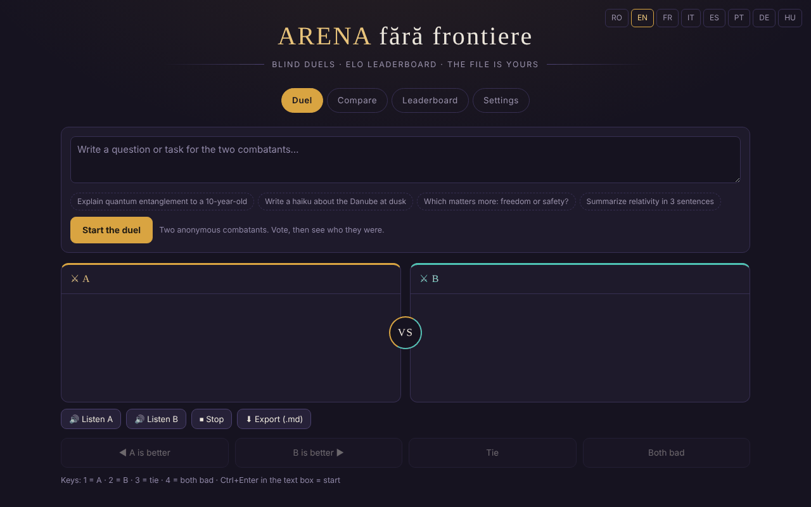

# Arena without borders

**English** · [Română](README.ro.md) · [Français](README.fr.md) · [Italiano](README.it.md) · [Español](README.es.md) · [Português](README.pt.md) · [Deutsch](README.de.md) · [Magyar](README.hu.md)

**Version:** 2.2.0 · **Last updated:** 2026-10-27

Interface languages: **Română, English, Français, Italiano, Español, Português (PT), Deutsch, Magyar**

**Status:** stable (2.2.0). The optional password encryption of API keys and the demo prompt sets are new; the encryption **has not been audited by a third party**.

**Offline:** partial. The interface loads offline after the first visit and the demo models and the in-browser engines work without a network; cloud models and local servers need a connection.

Blind duels between AI models, with a local Elo leaderboard — in a single HTML file.

**Live app:** https://chiuta.github.io/ARENA/

## What it is

ARENA is a single-file app (`index.html`, vanilla JavaScript) in which you compare two language models without knowing which is which: you send the same prompt to two anonymous "combatants", vote for the better answer, and then the app shows you who they were and updates an Elo leaderboard. The models can be cloud services (with your API key), local servers or in-browser engines; there are also demo models that work without any key.

## Features

- **Evaluation (2.0):** prompt sets (one line = one prompt, optionally `category | prompt`), consecutive blind-duel sessions, per-category Elo leaderboard (recomputed from history) and an exportable JSON report (no API keys, no prompt texts). All local.
- Four tabs: **Duel**, **Comparison**, **Leaderboard**, **Settings**.
- Blind duel: buttons "A is better", "B is better", "Tie", "Both bad"; after the vote the models are revealed.
- Comparison: you choose the two combatants yourself, with no vote and no Elo.
- Local Elo leaderboard (starts at 1000, K=32; a tie and "both bad" count as a draw), with a "Reset leaderboard" button.
- Settings: add/edit/delete models (name, provider, model ID, Base URL, API key), a "Test" button, "Test all active models".
- Provider types: OpenAI-compatible, Anthropic, Ollama (local), Pollinations (optional key), WebLLM (WebGPU), AI built into the browser (Gemini Nano), Transformers.js, plus demo models.
- A catalogue of integrable AIs (dated 29 July 2026, 181 entries, 68 providers according to the text in the app; not re-verified on 11 October 2026, see the note in the app), with filters, "+ Add all" and "⟳" to synchronise the model list from the provider.
- "Export everything (JSON)", "Import", "Delete everything".
- Keyboard shortcuts: `1` / `2` / `3` / `4` vote (A, B, tie, both bad) when you are not in a text field; `Ctrl`/`Cmd`+`Enter` in the text field starts the duel or the comparison.
- "Export leaderboard (CSV)" (in the Leaderboard tab): a locally generated file; names that begin with `=`, `+`, `-`, `@` are neutralised.
- An option in Settings: "Keep API keys only in the session" — the keys are no longer written to `localStorage` (they stay in `sessionStorage` and disappear when the tab is closed).
- Interface in 8 languages (RO / EN / FR / IT / ES / PT / DE / HU selector in the header; the demo combatants answer in the chosen language; the per-group notes in the AI catalogue remain in Romanian).

## User guide

1. Open the **Settings** tab and add at least two active combatants: press "+ Add model", fill in the provider, the model ID, the Base URL and the API key, then "Save". You can also use the demo models, without a key.
2. Press "Test" to check a model or "⚡ Test all active models" (note: each test uses up one call from the provider's quota; the app asks for confirmation).
3. Go to the **Duel** tab, write the question or task and press "Start duel". "Stop" interrupts the generation.
4. Read the two answers (A and B) and vote. Then you see the identity of the models and the result; "New duel" starts another.
5. The **Comparison** tab: choose two combatants manually and press "Compare" for a direct comparison without a score.
6. The **Leaderboard** tab: see the Elo score, the number of duels and wins/draws/losses; "Reset leaderboard" empties it.
7. Backup: in **Settings → Your data**, "Export everything (JSON)" saves models, keys and leaderboard; "Import" reloads them. The exported file contains the API keys, keep it safe.
8. Change the language from the selector in the header.

## Privacy and network

- **Local storage:** all the data (models, API keys, leaderboard, history) is saved in `localStorage` under the key `arena-ff-v1`. The API keys can be kept separately, only in `sessionStorage`, from Settings. If `localStorage` is not available, the data is lost when the page is closed.
- **Network:** the app has no server of its own and sends no telemetry. Chat requests go directly from the browser to the provider you configure (for example `api.openai.com`, `api.anthropic.com`, `gen.pollinations.ai`, `router.huggingface.co`, a local `localhost` server, etc.), with your key.
- **CDN:** only if you choose the in-browser engines, the modules are loaded from `vendor/` of the same origin (`@mlc-ai/web-llm@0.2.84`, `@huggingface/transformers@4.2.0`, no CDN); then the WebLLM model library (`.wasm`, pinned `binary-mlc-llm-libs` commit, verified by SHA-256 SRI) or the ONNX Runtime `.wasm` (pinned jsDelivr URL, SHA-256 verified, refused on mismatch) and the model weights (e.g. from Hugging Face, no pinned hash) are downloaded.
- **Cloud models disabled by default:** the catalogue models that do not require a key (Kilo Gateway, `api.kilo.ai`: Kilo Auto, GLM-5, MiniMax M2.5, StepFun Step 3.5 Flash) are added to the list but **disabled**; enabling them (a switch in **Settings**) requires explicit confirmation, and only then can a duel send them the prompt. On the first run after this version, models of this kind left active from a previous version are disabled once. Without consent, only the demo (offline) models are active.
- **API keys:** by default they are kept in plain text in `localStorage` (`arena-ff-v1`); with the "session only" option (Settings → Your data) they are kept only in `sessionStorage` (`arena-ff-v1-keys`) and are not written to disk, and at "Export everything" the app asks whether you want to include the keys (Cancel = export without keys). Anyone with access to the browser profile or running script on this origin can read them.
- The links in the catalogue (documentation, key consoles) open only on click.
- The demo models make no network calls.

- **CSP:** the page has a CSP policy: scripts only inline, by SHA-256 hash (no `'unsafe-inline'`), plus `'self'` (the in-browser engines come from `vendor/`), `https:`/`http:`/`ws:` connections (the providers' base addresses are configured by the user, so they cannot be enumerated), no objects, `base`/`form` blocked.

## Running locally / offline

Download `index.html` and open it in a browser. The demo models work fully offline. The cloud providers, the import of the WebLLM/Transformers.js engines and the catalogue synchronisation need internet; Ollama or another local server works over the local network, if the server accepts calls from the browser (CORS).

## Password encryption for API keys (since 2.1.0, optional)

In **Settings → Your data** there is a "Password protection" card. **Off by default**: keys keep working as before (plain `localStorage`, or `sessionStorage` with the "session only" option).

- When you turn it on, the keys of all models are encrypted with **AES-256-GCM**, with a key derived from your password through **PBKDF2-SHA256, 600,000 iterations and a random 16-byte salt**, and stored as one envelope in `arena-ff-v1-vault`. `arena-ff-v1` then contains no keys and the `sessionStorage` copy is removed. The old copies are replaced only after the envelope has been read back and decrypted successfully (migration without loss). "Turn off protection" puts the keys back after you confirm the password.
- The app asks for the password when it opens (you can dismiss the dialog and unlock later from Settings). Unlocked keys live in memory only; "Lock now" drops them. "Delete all data" also removes the vault. The unencrypted kit backup never contains the vault.
- **Honest limits:** the component is small and **has not been audited by a third party**; the password cannot be recovered (if you forget it, enter the keys again); it does not protect against a malicious script or extension running in the page while the keys are unlocked; a short password can be guessed offline. If you tick "Include API keys" in the export, the keys leave the vault in clear text in that file: your choice and your responsibility. The card's text exists in Romanian and English (other languages fall back to English).
- Tests: `node tests/keyvault-core.test.mjs` and `node tests/keyvault-ui.test.mjs`.
- Languages: the card and dialogs are available in all 8 interface languages (RO and EN written by hand; FR/IT/ES/PT/DE/HU are **machine translations, not verified by native speakers**). Test: `node tests/keyvault-i18n.test.mjs`.

## Demo prompt sets in Romanian (since 2.1.0)

In the **Evaluation** tab, "Add the demo sets (RO)" copies three sets with fixed IDs (`demo-ro-1`, `demo-ro-2`, `demo-ro-3`) into your list, so different people (or you, on different dates) can compare models on the **same prompts**:

| ID | Content (10 prompts each, each with a category) |
|---|---|
| `demo-ro-1` | Knowledge and reasoning: geography, history, science, logic, maths, culture, health, uncertainty (a trap question), ethics, unit conversion |
| `demo-ro-2` | Writing and the Romanian language: correction, summary, e-mail, verse, translation, tone, grammar, proverb, titles, constraint |
| `demo-ro-3` | Code, data and instructions: Python, SQL, regex, strict JSON, numbered steps, arithmetic, probability, debugging, safety |

**These are demonstration sets**: short, written by hand, not a statistically validated benchmark. They are copied, so you can edit or delete them; the "Export report (JSON)" button of the Evaluation tab records the set and the results. For repeatability keep the same model versions, the same sets and, where the provider allows it, the same temperature: the app does not control the models' randomness.

## New features (v1.1.0)

- **Reading the answers aloud** (the "Listen A" / "Listen B" / "Stop" buttons, under the duel and under the comparison; FFF.tts): it uses the system voice, and the text does not leave the browser. If the browser has no synthesiser, a message appears, not an error.
- **Export the duel / comparison as Markdown** ("Export (.md)"): the question and the two answers. Before the vote the duel remains blind: the file does not contain the model names and says so; after the vote, the names are included.
- **Transparency label and `.fff.json` copy** (common kit: core, label, bundle, tts): click on `v 1.1.0 · 2026-10-14`. **Note:** the copy also contains the API keys saved in `localStorage`; use "Encrypt with password" or the existing option "Keep API keys only in the session".
- Fixed: the contrast of the red colour of the negative score in the panel headers (axe-core color-contrast).
- The new texts are in ro, en, fr, it, es, pt, hu, de; the fr/it/es/pt/hu/de translations are automatic and not natively verified (the existing interface remains ro/en/fr).
- Tests: `tests/fff-r8.test.mjs` (network blocked, 1280 and 360 px, axe 0 violations, duel with demo models).

## History / Changelog

### 1.3.9 — 2026-10-23

- Accessibility: on touch screens (`pointer:coarse`) language, tab, suggestion, mini and chip buttons, selects and search fields are at least 44 px; model toggles get a 44 px touch area. No change on desktop.

### 1.3.6 — 2026-10-22
- The in-browser engines no longer depend on a CDN: WebLLM 0.2.84 and Transformers.js 4.2.0 (with the ONNX Runtime loaders) are in `vendor/`. The WebLLM model libraries (`.wasm`) come from a pinned `binary-mlc-llm-libs` commit and are verified by SHA-256 SRI; the ONNX Runtime `.wasm` is verified by SHA-256 before use (refused on mismatch). The CSP drops `esm.run` and `cdn.jsdelivr.net` from `script-src`.
- The page is no longer a single file when you use these engines (the engines are in `vendor/`, +6.4 MB). New `NOTICE.md`.

### 1.3.5 — 2026-10-22
- fff-kit 1.1.4: touch targets and minimum text size

### 1.3.4 — 2026-10-22
- fff-kit 1.1.2: PBKDF2 600,000 iterations, anti-clickjacking protection

### 1.3.2 — 2026-10-22
- The cloud-models privacy note (Settings and Duel) is now shown only in the current interface language instead of the bilingual Romanian · English text, translated into fr, it, es, pt, de and hu.

### 1.3.1 — 2026-10-22
- The provider catalog in Settings (group names, per-provider notes, model labels, provider options and error codes) is now translated into all eight languages instead of staying Romanian.

### 1.2.0 — 2026-10-18
- Security: the export from Settings NO LONGER includes the API keys unless you tick "Include API keys…" and confirm; the unencrypted backup copy from the kit (1.1.0) empties the keys (the password-encrypted one keeps them). Restoring an unencrypted copy no longer brings the keys back: they are re-entered manually.

### 1.1.0 — 2026-10-14
- New: reading the answers aloud, export of the duel/comparison to Markdown, transparency label and `.fff.json` copy (common kit); contrast fixed.

### 12 October 2026 (v1.0.0)
- 1.3.3 — 2026-10-22: The six window.confirm prompts (reset, delete model, cloud consent, key export, wipe data, bulk test) are replaced by in-page dialogs; the invalid-JSON import message is translated; minimum text size 12 px.

- 1.0.0 — 2026-10-12: the version and the date of the last update are shown in the app

### 11 October 2026 (third entry)
- Interface in French (≈110 texts, including the demo combatants and the catalogue note), alongside Romanian and English.
- Fixed: the text of a previous notification (toast) remained in the `aria-live` region after it disappeared; saving a model without a name now shows a message and marks the field `aria-invalid` (before, nothing visible happened).

### 11 October 2026 (second entry)
- Security: CSP with `script-src` by hash (no `'unsafe-inline'`); the "API keys only in the session" option.
- Keyboard shortcuts for voting and starting, CSV export of the leaderboard; new texts in Romanian and English.

### 11 October 2026
- Accessibility: `h1` heading added, the language selector as a labelled <nav> (axe: 0 violations).
- The demo answers now carry a visible note that they are generated from a style template, not by a real model.
- The AI catalogue: the note in the app (RO/EN) states that the last check was on 29 July 2026 and that it was not re-verified on 11 October 2026.
- CSP added (scripts only inline + esm.run/cdn.jsdelivr.net; no objects).

## Licence

MIT for the app's code and structure — see the `LICENSE` file. Any third-party libraries included in the file keep their own licences.

## Author

Alexio — Alexandru-Ionuț Chiuță, contact: alexio@trom.tf.

## Summary

ARENA is a single-file HTML app for blind head-to-head duels between AI models with a local Elo leaderboard. Models can be cloud APIs (your own key), local servers (e.g. Ollama) or in-browser engines; demo models work offline. Data stays in localStorage (`arena-ff-v1`); requests go straight from the browser to the provider you configure. UI in 8 languages. Licence: MIT (see LICENSE).

Audit: 2026-10-10 (round 2: 2026-10-11, cloud models disabled by default, export with/without keys) — verified the code (network requests, sanitisation of the imported state, rendering of the answers through textContent), accessibility (axe: contrast corrected) and operation (duel with demo models, tabs). The in-browser engines (WebLLM/Transformers.js) are optional and are loaded from `vendor/` only on request.
