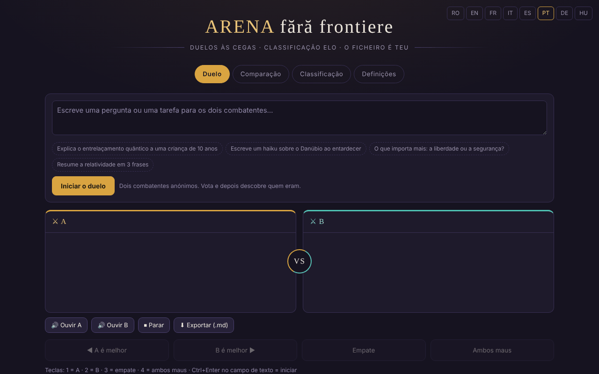

# Arena sem fronteiras

[English](README.md) · [Română](README.ro.md) · [Français](README.fr.md) · [Italiano](README.it.md) · [Español](README.es.md) · **Português** · [Deutsch](README.de.md) · [Magyar](README.hu.md)

**Versão:** 1.3.9 · **Última atualização:** 2026-10-23

Idiomas da interface: **Română, English, Français, Italiano, Español, Português (PT), Deutsch, Magyar**

Duelos às cegas entre modelos de IA, com classificação Elo local — num único ficheiro HTML.

**Aplicação online:** https://chiuta.github.io/ARENA/

## O que é

O ARENA é uma aplicação de um único ficheiro (`index.html`, JavaScript puro) em que compara dois modelos de linguagem sem saber qual é qual: envia o mesmo prompt a dois «combatentes» anónimos, vota na melhor resposta e depois a aplicação mostra quem eram e atualiza uma classificação Elo. Os modelos podem ser serviços na nuvem (com a sua chave API), servidores locais ou motores no navegador; existem também modelos de demonstração que funcionam sem qualquer chave.

## Funcionalidades

- Quatro separadores: **Duelo**, **Comparação**, **Classificação**, **Definições**.
- Duelo às cegas: botões «A é melhor», «B é melhor», «Empate», «Ambos maus»; após o voto os modelos são revelados.
- Comparação: escolhe você os dois combatentes, sem voto e sem Elo.
- Classificação Elo local (parte de 1000, K=32; o empate e «ambos maus» contam como empate), com um botão «Repor a classificação».
- Definições: adicionar/editar/eliminar modelos (nome, fornecedor, ID do modelo, Base URL, chave API), botão «Testar», «Testar todos os modelos ativos».
- Tipos de fornecedores: compatíveis com a OpenAI, Anthropic, Ollama (local), Pollinations (chave opcional), WebLLM (WebGPU), IA incorporada no navegador (Gemini Nano), Transformers.js, além de modelos de demonstração.
- Um catálogo de IA integráveis (datado de 29 de julho de 2026, 181 entradas, 68 fornecedores segundo o texto da aplicação; não reverificado a 11 de outubro de 2026, veja a nota na aplicação), com filtros, «+ Adicionar todos» e «⟳» para sincronizar a lista de modelos a partir do fornecedor.
- «Exportar tudo (JSON)», «Importar», «Eliminar tudo».
- Atalhos de teclado: `1` / `2` / `3` / `4` votam (A, B, empate, ambos maus) quando não está num campo de texto; `Ctrl`/`Cmd`+`Enter` no campo de texto inicia o duelo ou a comparação.
- «Exportar a classificação (CSV)» (no separador Classificação): ficheiro gerado localmente; os nomes que começam por `=`, `+`, `-`, `@` são neutralizados.
- Opção nas Definições: «Guardar as chaves API apenas durante a sessão» — as chaves deixam de ser escritas no `localStorage` (ficam no `sessionStorage` e desaparecem ao fechar o separador).
- Interface em 8 idiomas (seletor RO / EN / FR / IT / ES / PT / DE / HU no cabeçalho; os combatentes de demonstração respondem no idioma escolhido; as notas por grupo do catálogo de IA permanecem em romeno).

## Manual de utilização

1. Abra o separador **Definições** e adicione pelo menos dois combatentes ativos: prima «+ Adicionar modelo», preencha o fornecedor, o ID do modelo, a Base URL e a chave API, e depois «Guardar». Pode também usar os modelos de demonstração, sem chave.
2. Prima «Testar» para verificar um modelo ou «⚡ Testar todos os modelos ativos» (atenção: cada teste consome uma chamada da quota do fornecedor; a aplicação pede confirmação).
3. Vá ao separador **Duelo**, escreva a pergunta ou a tarefa e prima «Iniciar o duelo». «Parar» interrompe a geração.
4. Leia as duas respostas (A e B) e vote. Depois vê a identidade dos modelos e o resultado; «Duelo novo» inicia outro.
5. Separador **Comparação**: escolha manualmente dois combatentes e prima «Comparar» para uma comparação direta sem pontuação.
6. Separador **Classificação**: veja a pontuação Elo, o número de duelos e vitórias/empates/derrotas; «Repor a classificação» esvazia-a.
7. Cópia de segurança: em **Definições → Os seus dados**, «Exportar tudo (JSON)» guarda modelos, chaves e classificação; «Importar» recarrega-os. O ficheiro exportado contém as chaves API, guarde-o em segurança.
8. Mude o idioma no seletor do cabeçalho.

## Privacidade e rede

- **Armazenamento local:** todos os dados (modelos, chaves API, classificação, histórico) são guardados no `localStorage` sob a chave `arena-ff-v1`. As chaves API podem ser guardadas em separado, apenas no `sessionStorage`, a partir das Definições. Se o `localStorage` não estiver disponível, os dados perdem-se ao fechar a página.
- **Rede:** a aplicação não tem servidor próprio e não envia telemetria. Os pedidos de chat partem diretamente do navegador para o fornecedor que configurar (por exemplo `api.openai.com`, `api.anthropic.com`, `gen.pollinations.ai`, `router.huggingface.co`, um servidor local `localhost`, etc.), com a sua chave.
- **CDN:** apenas se escolher os motores no navegador, os módulos são carregados de `vendor/` da mesma origem (`@mlc-ai/web-llm@0.2.84`, `@huggingface/transformers@4.2.0`, sem CDN); depois descarregam-se a biblioteca de modelo do WebLLM (`.wasm`, commit de `binary-mlc-llm-libs` fixo, verificada com SRI SHA-256) ou o `.wasm` do ONNX Runtime (URL do jsDelivr fixo, SHA-256 verificado, recusado se diferir) e os pesos dos modelos (p. ex. do Hugging Face, sem hash fixo).
- **Modelos na nuvem desativados por predefinição:** os modelos do catálogo que não exigem chave (Kilo Gateway, `api.kilo.ai`: Kilo Auto, GLM-5, MiniMax M2.5, StepFun Step 3.5 Flash) são adicionados à lista mas **desativados**; a sua ativação (interruptor nas **Definições**) exige confirmação explícita, e só então um duelo lhes pode enviar o prompt. Na primeira execução após esta versão, os modelos deste tipo que tenham ficado ativos de uma versão anterior são desativados uma única vez. Sem consentimento, apenas os modelos de demonstração (offline) estão ativos.
- **Chaves API:** por predefinição são guardadas em claro no `localStorage` (`arena-ff-v1`); com a opção «apenas durante a sessão» (Definições → Os seus dados) são guardadas apenas no `sessionStorage` (`arena-ff-v1-keys`) e não são escritas em disco, e ao «Exportar tudo» a aplicação pergunta se quer incluir as chaves (Cancelar = exportação sem chaves). Qualquer pessoa com acesso ao perfil do navegador ou que execute um script nesta origem pode lê-las.
- As ligações do catálogo (documentações, consolas de chaves) só se abrem ao clicar.
- Os modelos de demonstração não fazem nenhuma chamada de rede.

- **CSP:** a página tem uma política CSP: scripts apenas em linha, por hash SHA-256 (sem `'unsafe-inline'`), além de `'self'` (os motores no navegador vêm de `vendor/`), ligações `https:`/`http:`/`ws:` (os endereços de base dos fornecedores são configurados pelo utilizador, pelo que não podem ser enumerados), sem objetos, `base`/`form` bloqueados.

## Execução local / offline

Descarregue `index.html` e abra-o num navegador. Os modelos de demonstração funcionam totalmente offline. Os fornecedores na nuvem, a importação dos motores WebLLM/Transformers.js e a sincronização do catálogo exigem internet; o Ollama ou outro servidor local funciona com a rede local, se o servidor aceitar chamadas do navegador (CORS).

## Novas funcionalidades (v1.1.0)

- **Leitura das respostas em voz alta** (botões «Ouvir A» / «Ouvir B» / «Parar», por baixo do duelo e da comparação; FFF.tts): usa a voz do sistema e o texto não sai do navegador. Se o navegador não tiver sintetizador, aparece uma mensagem, não um erro.
- **Exportação do duelo / comparação como Markdown** («Exportar (.md)»): a pergunta e as duas respostas. Antes do voto o duelo continua às cegas: o ficheiro não contém os nomes dos modelos e di-lo; depois do voto, os nomes são incluídos.
- **Etiqueta de transparência e cópia .fff.json** (kit comum: core, label, bundle, tts): clique em `v 1.1.0 · 2026-10-14`. **Atenção:** a cópia contém também as chaves API guardadas no `localStorage`; use «Cifrar com palavra-passe» ou a opção existente «Guardar as chaves API apenas durante a sessão».
- Corrigido: o contraste da cor vermelha da pontuação negativa nos cabeçalhos dos painéis (axe-core color-contrast).
- Os textos novos estão em ro, en, fr, it, es, pt, hu, de; as traduções fr/it/es/pt/hu/de são automáticas e não verificadas por nativos (a interface existente continua ro/en/fr).
- Testes: `tests/fff-r8.test.mjs` (rede bloqueada, 1280 e 360 px, axe 0 violações, duelo com modelos de demonstração).

## Histórico / Registo de alterações

### 1.3.6 — 2026-10-22
- Os motores no navegador já não dependem de uma CDN: o WebLLM 0.2.84 e o Transformers.js 4.2.0 (com os carregadores do ONNX Runtime) estão em `vendor/`. As bibliotecas de modelo do WebLLM (`.wasm`) vêm de um commit fixo de `binary-mlc-llm-libs` e são verificadas com SRI SHA-256; o `.wasm` do ONNX Runtime é verificado com SHA-256 antes de ser usado (recusado se diferir). A CSP retira `esm.run` e `cdn.jsdelivr.net` de `script-src`.
- A página já não é um único ficheiro quando usa estes motores (os motores estão em `vendor/`, +6,4 MB). Novo `NOTICE.md`.

### 1.3.5 — 2026-10-22
- fff-kit 1.1.4: alvos de toque e tamanho mínimo do texto

### 1.3.4 — 2026-10-22
- fff-kit 1.1.2: PBKDF2 600 000 iterações, proteção anti-clickjacking

### 1.3.2 — 2026-10-22
- A nota de privacidade sobre os modelos na nuvem (Definições e Duelo) aparece agora apenas na língua atual da interface, e não bilingue romeno · inglês; traduzida para fr, it, es, pt, de e hu.

### 1.3.1 — 2026-10-22
- O catálogo de fornecedores nas Definições (nomes de grupos, notas por fornecedor, etiquetas de modelos, opções de fornecedor e códigos de erro) está agora traduzido nos oito idiomas, em vez de ficar em romeno.

### 1.2.0 — 2026-10-18
- Segurança: a exportação a partir das Definições JÁ NÃO inclui as chaves API, a menos que assinale «Incluir as chaves API…» e confirme; a cópia de segurança não cifrada do kit (1.1.0) esvazia as chaves (a cifrada com palavra-passe mantém-nas). O restauro de uma cópia não cifrada já não traz as chaves de volta: reintroduzem-se manualmente.

### 1.1.0 — 2026-10-14
- Novidade: leitura das respostas em voz alta, exportação do duelo/comparação para Markdown, etiqueta de transparência e cópia .fff.json (kit comum); contraste corrigido.

### 12 de outubro de 2026 (v1.0.0)
- 1.3.3 — 2026-10-22: Os seis window.confirm (reposição, eliminação de modelo, consentimento cloud, exportação de chaves, apagar dados, teste em massa) foram substituídos por diálogos integrados; a mensagem de importação de JSON inválido está traduzida; tamanho mínimo do texto 12 px.

- 1.0.0 — 2026-10-12: a versão e a data da última atualização são apresentadas na aplicação

### 11 de outubro de 2026 (terceira entrada)
- Interface em francês (≈110 textos, incluindo os combatentes de demonstração e a nota do catálogo), a par do romeno e do inglês.
- Corrigido: o texto de uma notificação (toast) anterior permanecia na região `aria-live` depois de desaparecer; guardar um modelo sem nome mostra agora uma mensagem e marca o campo `aria-invalid` (antes não acontecia nada visível).

### 11 de outubro de 2026 (segunda entrada)
- Segurança: CSP com `script-src` por hash (sem `'unsafe-inline'`); opção «chaves API apenas durante a sessão».
- Atalhos de teclado para votar e iniciar, exportação CSV da classificação; textos novos em romeno e inglês.

### 11 de outubro de 2026
- Acessibilidade: título `h1` acrescentado, seletor de idioma como <nav> etiquetado (axe: 0 violações).
- As respostas de demonstração trazem agora uma nota visível a indicar que são geradas a partir de um modelo de estilo, e não por um modelo real.
- O catálogo de IA: a nota na aplicação (RO/EN) esclarece que a última verificação foi a 29 de julho de 2026 e que não foi reverificado a 11 de outubro de 2026.
- CSP acrescentada (scripts apenas em linha + esm.run/cdn.jsdelivr.net; sem objetos).

## Licença

MIT para o código e a estrutura da aplicação — consulte o ficheiro `LICENSE`. As eventuais bibliotecas de terceiros incluídas no ficheiro mantêm as suas próprias licenças.

## Autor

Alexio — Alexandru-Ionuț Chiuță, contacto: alexio@trom.tf.

## Resumo

O ARENA é uma aplicação HTML de um único ficheiro para duelos às cegas frente a frente entre modelos de IA com uma classificação Elo local. Os modelos podem ser API na nuvem (a sua própria chave), servidores locais (p. ex. Ollama) ou motores no navegador; os modelos de demonstração funcionam offline. Os dados ficam no localStorage (`arena-ff-v1`); os pedidos vão diretamente do navegador para o fornecedor que configurar. Interface em 8 idiomas. Licença: MIT (veja LICENSE).

Auditoria: 2026-10-10 (ronda 2: 2026-10-11, modelos na nuvem desativados por predefinição, exportação com/sem chaves) — verificados o código (pedidos de rede, saneamento do estado importado, apresentação das respostas através de textContent), a acessibilidade (axe: contraste corrigido) e o funcionamento (duelo com modelos de demonstração, separadores). Os motores no navegador (WebLLM/Transformers.js) são opcionais e só são carregados a partir de `vendor/` a pedido.
