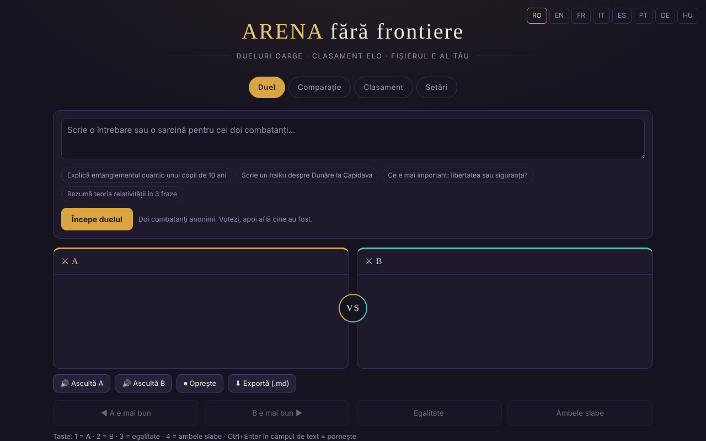

# Arena fără frontiere

[English](README.md) · **Română** · [Français](README.fr.md) · [Italiano](README.it.md) · [Español](README.es.md) · [Português](README.pt.md) · [Deutsch](README.de.md) · [Magyar](README.hu.md)

**Versiune:** 1.3.10 · **Ultima actualizare:** 2026-10-26

Limbile interfeței: **Română, English, Français, Italiano, Español, Português (PT), Deutsch, Magyar**

Dueluri oarbe între modele AI, cu clasament Elo local — într-un singur fișier HTML.

**Live:** https://chiuta.github.io/ARENA/

## Ce este

ARENA este o aplicație single-file (`index.html`, JavaScript vanilla) în care compari două modele de limbaj fără să știi care este care: trimiți același prompt la doi „combatanți” anonimi, votezi răspunsul mai bun, apoi aplicația îți arată cine au fost și actualizează un clasament Elo. Modelele pot fi servicii cloud (cu cheia ta API), servere locale sau motoare din browser; există și modele demo care funcționează fără nicio cheie.

## Funcții

- Patru file: **Duel**, **Comparație**, **Clasament**, **Setări**.
- Duel orb: butoane „A e mai bun”, „B e mai bun”, „Egalitate”, „Ambele slabe”; după vot se dezvăluie modelele.
- Comparație: alegi tu cei doi combatanți, fără vot și fără Elo.
- Clasament Elo local (pornește de la 1000, K=32; egalitatea și „ambele slabe” contează ca remiză), cu buton „Resetează clasamentul”.
- Setări: adăugare/editare/ștergere de modele (nume, provider, ID model, Base URL, cheie API), buton „Test”, „Testează toate modelele active”.
- Provideri tip: compatibili OpenAI, Anthropic, Ollama (local), Pollinations (cheie opțională), WebLLM (WebGPU), AI încorporat în browser (Gemini Nano), Transformers.js, plus modele demo.
- Catalog de AI-uri integrabile (datat 29 iulie 2026, 181 de intrări, 68 de provideri conform textului din aplicație; nereverificat la 11 octombrie 2026, vezi nota din aplicație), cu filtre, „+ Adaugă toate” și „⟳” pentru sincronizarea listei de modele de la provider.
- „Exportă tot (JSON)”, „Importă”, „Șterge tot”.
- Scurtături de tastatură: `1` / `2` / `3` / `4` votează (A, B, egalitate, ambele slabe) când nu ești într-un câmp de text; `Ctrl`/`Cmd`+`Enter` în câmpul de text pornește duelul sau compararea.
- „Exportă clasamentul (CSV)" (în fila Clasament): fișier generat local; numele care încep cu `=`, `+`, `-`, `@` sunt neutralizate.
- Opțiune în Setări: „Păstrează cheile API doar în sesiune" — cheile nu se mai scriu în `localStorage` (rămân în `sessionStorage` și dispar la închiderea filei).
- Interfață în 8 limbi (selector RO / EN / FR / IT / ES / PT / DE / HU în antet; combatanții demo răspund în limba aleasă; notele per grup din catalogul de AI-uri rămân în română).

## Manual de utilizare

1. Deschide fila **Setări** și adaugă cel puțin doi combatanți activi: apasă „+ Adaugă model”, completează providerul, ID-ul modelului, Base URL și cheia API, apoi „Salvează”. Poți folosi și modelele demo, fără cheie.
2. Apasă „Test” pentru a verifica un model sau „⚡ Testează toate modelele active” (atenție: fiecare test consumă un apel din cota providerului; aplicația cere confirmare).
3. Mergi la fila **Duel**, scrie întrebarea sau sarcina și apasă „Începe duelul”. „Oprește” întrerupe generarea.
4. Citește cele două răspunsuri (A și B) și votează. Apoi vezi identitatea modelelor și rezultatul; „Duel nou” pornește altul.
5. Fila **Comparație**: alege manual doi combatanți și apasă „Compară” pentru o comparație directă fără scor.
6. Fila **Clasament**: vezi scorul Elo, numărul de dueluri și victorii/egalități/înfrângeri; „Resetează clasamentul” îl golește.
7. Backup: în **Setări → Datele tale**, „Exportă tot (JSON)” salvează modele, chei și clasament; „Importă” le reîncarcă. Fișierul exportat conține cheile API, păstrează-l în siguranță.
8. Schimbă limba din selectorul din antet.

## Confidențialitate și rețea

- **Stocare locală:** toate datele (modele, chei API, clasament, istoric) se salvează în `localStorage` sub cheia `arena-ff-v1`. Cheile API pot fi ținute separat, doar în `sessionStorage`, din Setări. Dacă `localStorage` nu e disponibil, datele se pierd la închiderea paginii.
- **Rețea:** aplicația nu are server propriu și nu trimite telemetrie. Cererile de chat pleacă direct din browser către providerul pe care îl configurezi (de exemplu `api.openai.com`, `api.anthropic.com`, `gen.pollinations.ai`, `router.huggingface.co`, un server local `localhost` etc.), cu cheia ta.
- **CDN:** doar dacă alegi motoarele din browser, modulele se încarcă din `vendor/` (aceeași origine; `@mlc-ai/web-llm@0.2.84`, `@huggingface/transformers@4.2.0`, fără CDN); apoi se descarcă biblioteca modelului WebLLM (`.wasm`, commit `binary-mlc-llm-libs` fixat, verificată prin SRI SHA-256) sau `.wasm`-ul ONNX Runtime (URL jsDelivr fixat, verificat SHA-256, refuzat la nepotrivire) și ponderile modelelor (de ex. de la Hugging Face, fără hash fixat).
- **Modele cloud dezactivate implicit:** modelele din catalog care nu cer cheie (Kilo Gateway, `api.kilo.ai`: Kilo Auto, GLM-5, MiniMax M2.5, StepFun Step 3.5 Flash) sunt adăugate în listă dar **dezactivate**; activarea lor (comutator în **Setări**) cere confirmare explicită, iar abia apoi un duel le poate trimite promptul. La prima rulare după această versiune, modelele de acest fel rămase active dintr-o versiune anterioară sunt dezactivate o singură dată. Fără acord, doar modelele demo (offline) sunt active.
- **Chei API:** implicit se păstrează în clar în `localStorage` (`arena-ff-v1`); cu opțiunea „doar în sesiune" (Setări → Datele tale) se păstrează numai în `sessionStorage` (`arena-ff-v1-keys`) și nu se scriu pe disc și, la „Exportă tot”, aplicația întreabă dacă vrei să incluzi cheile (Anulează = export fără chei). Oricine are acces la profilul browserului sau rulează script pe această origine le poate citi.
- Linkurile din catalog (documentații, console de chei) se deschid doar la click.
- Modelele demo nu fac niciun apel de rețea.

- **CSP:** pagina are o politică CSP: scripturi doar inline, pe bază de hash SHA-256 (fără `'unsafe-inline'`), plus `'self'` (motoarele din browser vin din `vendor/`), conexiuni `https:`/`http:`/`ws:` (adresele de bază ale providerilor sunt configurate de utilizator, deci nu pot fi enumerate), fără obiecte, `base`/`form` blocate.

## Rulare locală / offline

Descarcă `index.html` și deschide-l în browser. Modelele demo funcționează complet offline. Providerii cloud, importul motoarelor WebLLM/Transformers.js și sincronizarea catalogului cer internet; Ollama sau alt server local funcționează cu rețeaua locală, dacă serverul acceptă apeluri din browser (CORS).

## Funcții noi (v1.1.0)

- **Citirea răspunsurilor cu voce** (butoanele „Ascultă A” / „Ascultă B” / „Oprește”, sub duel și sub comparație; FFF.tts): folosește vocea sistemului, textul nu pleacă din browser. Dacă browserul nu are sintetizator, apare un mesaj, nu o eroare.
- **Export duel / comparație ca Markdown** („Exportă (.md)”): întrebarea și cele două răspunsuri. Înainte de vot duelul rămâne orb: fișierul nu conține numele modelelor și o spune; după vot, numele sunt incluse.
- **Etichetă de transparență și copie .fff.json** (kit comun: core, label, bundle, tts): clic pe `v 1.1.0 · 2026-10-14`. **Atenție:** copia conține și cheile API salvate în `localStorage`; folosește „Criptează cu parolă” sau opțiunea existentă „Păstrează cheile API doar în sesiune”.
- Reparat: contrastul culorii roșii a scorului negativ din antetul panourilor (axe-core color-contrast).
- Textele noi sunt în ro, en, fr, it, es, pt, hu, de; traducerile fr/it/es/pt/hu/de sunt automate și neverificate nativ (interfața existentă rămâne ro/en/fr).
- Teste: `tests/fff-r8.test.mjs` (rețea blocată, 1280 și 360 px, axe 0 violări, duel cu modele demo).

## Istoric / Changelog

### 1.3.6 — 2026-10-22
- Motoarele din browser nu mai depind de un CDN: WebLLM 0.2.84 și Transformers.js 4.2.0 (cu încărcătoarele ONNX Runtime) sunt în `vendor/`. Bibliotecile de model WebLLM (`.wasm`) vin de la un commit `binary-mlc-llm-libs` fixat și sunt verificate prin SRI SHA-256; `.wasm`-ul ONNX Runtime se verifică SHA-256 înainte de folosire (refuzat la nepotrivire). CSP-ul scoate `esm.run` și `cdn.jsdelivr.net` din `script-src`.
- Pagina nu mai este un singur fișier când folosești aceste motoare (motoarele sunt în `vendor/`, +6,4 MB). `NOTICE.md` nou.

### 1.3.5 — 2026-10-22
- fff-kit 1.1.4: ținte tactile și text minim

### 1.3.4 — 2026-10-22
- fff-kit 1.1.2: PBKDF2 600 000 iterații, protecție anti-clickjacking

### 1.3.2 — 2026-10-22
- Nota de confidențialitate despre modelele cloud (Setări și Duel) apare acum doar în limba curentă a interfeței, nu bilingv română · engleză; tradusă în fr, it, es, pt, de și hu.

### 1.3.1 — 2026-10-22
- Catalogul de provideri din Setări (nume de grupuri, note pe provider, etichete de modele, opțiunile de provider și codurile de eroare) este acum tradus în toate cele opt limbi, nu mai rămâne în română.

### 1.2.0 — 2026-10-18
- Securitate: exportul din Setări NU mai include cheile API decât dacă bifezi „Include cheile API…” și confirmi; copia de siguranță necriptată din kit (1.1.0) golește cheile (cea criptată cu parolă le păstrează). Restaurarea unei copii necriptate nu mai readuce cheile: se reintroduc manual.

### 1.1.0 — 2026-10-14
- Nou: citire cu voce a răspunsurilor, export duel/comparație în Markdown, etichetă de transparență și copie .fff.json (kit comun); contrast reparat.

### 12 octombrie 2026 (v1.0.0)
- 1.3.3 — 2026-10-22: Cele șase window.confirm (resetare, ștergere model, acord cloud, export chei, ștergere date, test în masă) sunt înlocuite cu dialoguri în pagină; mesajul de import JSON invalid este tradus; dimensiune minimă a textului 12 px.

- 1.0.0 — 2026-10-12: versiunea și data ultimei actualizări sunt afișate în aplicație

### 11 octombrie 2026 (a treia intrare)
- Interfață în franceză (≈110 texte, inclusiv combatanții demo și nota catalogului), alături de română și engleză.
- Corectat: textul unei notificări (toast) anterioare rămânea în regiunea `aria-live` după dispariție; salvarea unui model fără nume afișează acum un mesaj și marchează câmpul `aria-invalid` (înainte nu se întâmpla nimic vizibil).

### 11 octombrie 2026 (a doua intrare)
- Securitate: CSP cu `script-src` pe hash (fără `'unsafe-inline'`); opțiune „cheile API doar în sesiune".
- Scurtături de tastatură pentru vot și pornire, export CSV al clasamentului; texte noi în română și engleză.

### 11 octombrie 2026
- Accesibilitate: titlu `h1` adăugat, selectorul de limbă ca <nav> etichetat (axe: 0 violări).
- Răspunsurile demo poartă acum o notă vizibilă că sunt generate dintr-un șablon de stil, nu de un model real.
- Catalogul de AI-uri: nota din aplicație (RO/EN) precizează că ultima verificare a fost la 29 iulie 2026 și că nu a fost reverificat la 11 octombrie 2026.
- Adăugat CSP (scripturi doar inline + esm.run/cdn.jsdelivr.net; fără obiecte).

## Licență

MIT pentru codul și structura aplicației — vezi fișierul `LICENSE`. Eventualele biblioteci terțe incluse în fișier își păstrează licențele proprii.

## Autor

Alexio — Alexandru-Ionuț Chiuță, contact: alexio@trom.tf.

## Rezumat

ARENA este o aplicație într-un singur fișier HTML pentru dueluri „în orb” între modele AI, cu un clasament Elo local. Modelele pot fi API-uri în cloud (cu cheia ta), servere locale (de ex. Ollama) sau motoare din browser; modelele demo funcționează offline. Datele rămân în localStorage (`arena-ff-v1`); cererile pleacă direct din browser către furnizorul configurat. Interfață în 8 limbi. Licență: MIT (vezi LICENSE).

Audit: 2026-10-10 (rundă 2: 2026-10-11, modele cloud dezactivate implicit, export cu/fără chei) — verificat codul (cereri de rețea, sanitizare stare importată, redarea răspunsurilor prin textContent), accesibilitate (axe: contrast corectat) și funcționarea (duel cu modele demo, file). Motoarele din browser (WebLLM/Transformers.js) sunt opționale și se încarcă din `vendor/` doar la cerere.
